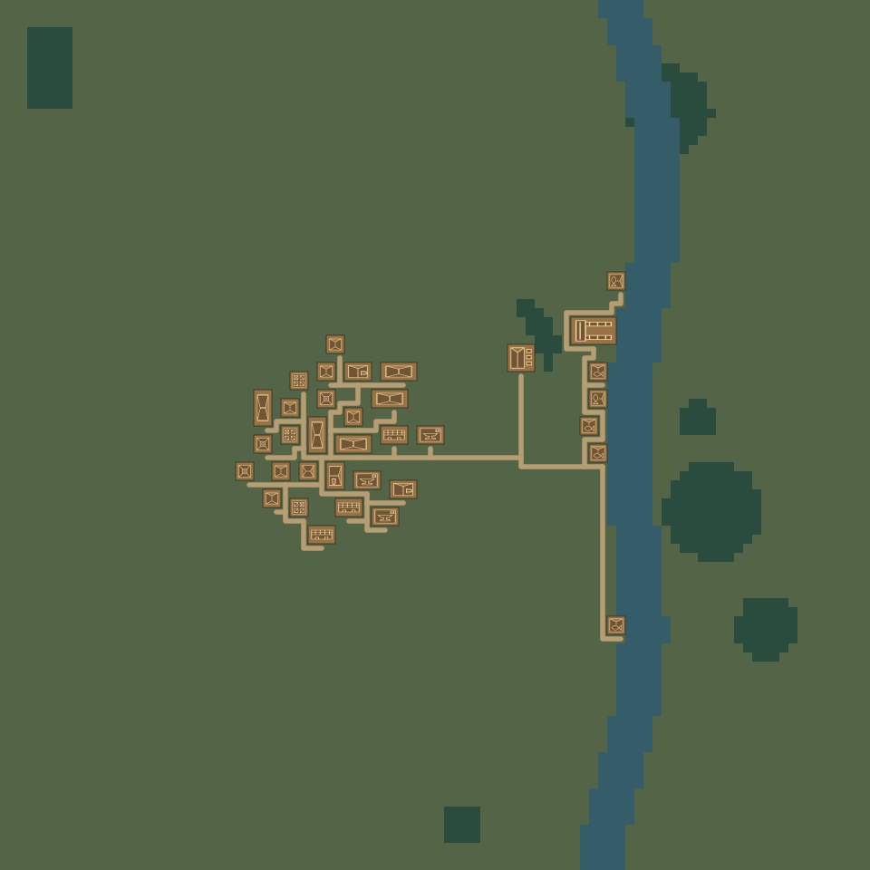
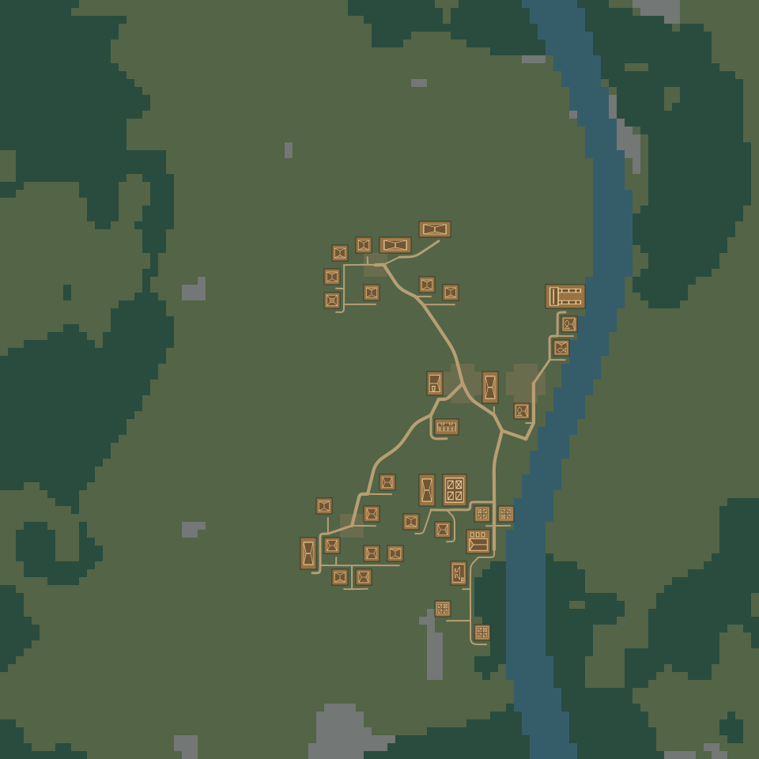

# Phase 2 → Phase 2.1 visual comparison

Both images use **Viking Fishing Village · River · Contextual · seed 1847 · 96×96 · 35 buildings**, with required longhouse 1, fishing huts 3, harbour 1, sawmill 1. Same map extent, colours and original building symbols. The baseline is the unedited Phase 2 export from commit `4dcf45ec311307dad606a2e4be7aa2db041fe25a`; the improved image comes from the Phase 2.1 generator. The SVGs are static document-derived reference artifacts, not hand-drawn mockups.

| Original Phase 2 | Improved Phase 2.1 |
| --- | --- |
|  |  |

Open the SVG links in separate tabs and zoom in to compare the central gathering ground, northern/southern homesteads, waterfront working area, path junctions and woodland edges. SVGs scale without blurring.

| Reference-map result | Phase 2 | Phase 2.1 |
| --- | ---: | ---: |
| Buildings | 35 | 35 |
| Distinct quarter-turn orientations | 2 | 4 |
| Preplanned neighbourhood anchors | none | 4 |
| Reserved gathering/working/expansion/yard areas | none | 5 |
| Forest tiles | 262 | 2,032 |
| Rocky tiles | 0 | 131 |
| Paths | 35 uniform building paths | 5 primary, 5 secondary, 30 access |
| Taverns / blacksmiths / markets | 3 / 3 / 3 | 1 / 1 / 1 |

The important change is the arrangement, not the number of paths: routes now precede development, houses occupy distinct pockets, a prominent hall overlooks the gathering place, waterfront access is protected, and services are selected with seeded weights and sensible limits. The logical route graph still uses valid adjacent grid cells. Rendering safely rounds and simplifies paths through clear ground without moving logical entrances or junctions.

## Reproduce in the studio

1. Save or export your current project if you want to keep a separate copy.
2. Open **New**, retain the default Viking/River/Contextual/1847/96×96/35 settings, and verify the required quantities above.
3. Generate a complete settlement, inspect the preview, then explicitly confirm replacement if desired.
4. Close Library/Properties, use **Fit**, and optionally hide the grid for an unobstructed comparison. Select buildings to inspect positions and dimensions; all editing tools still work.
5. Generate again with the same settings to check repeatability. Switching to **Planned** intentionally produces more regular alignment and straight logical paths.

Existing saved Phase 2 documents retain their original terrain, buildings and roads. Opening a saved project does not regenerate it. Phase 2.1 changes only newly generated drafts; comparing against an old export or these baseline images requires no reset, branch checkout or overwrite.

## Current limits

Buildings still rotate in 90° increments. Terrain and collision rules remain grid-based. Planning is heuristic: very small or resource-constrained maps may reject requested quotas with a specific error instead of returning a partial village. Optional supporting structures may switch to a suitable smaller homestead if their preferred resource location is full; required quantities never use this fallback. Waterfront structures remain on accessible banks; automatic water crossings, multi-bank expansion, dynamic rerouting after manual edits and elevation are outside this phase.
