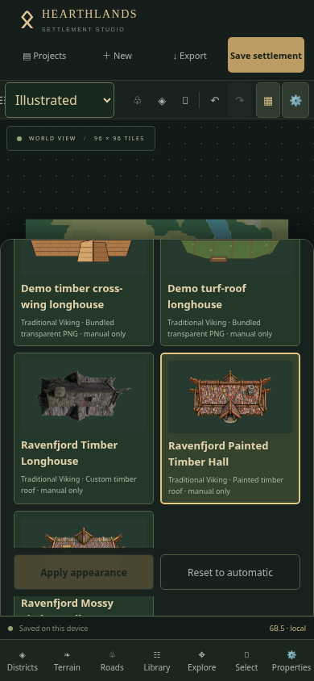
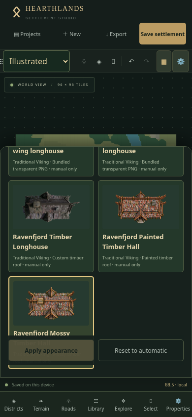

# Ravenfjord longhouse comparison assets

Installed only the two requested files from the supplied comparison ZIP, byte-for-byte, alongside the unchanged original Longhouse 01. No source artwork, preview JPEG, instructions or other files from the ZIP were installed as assets.

| Asset ID | Appearance | Supplied file SHA-256 |
| --- | --- | --- |
| `hearthlands.viking.longhouse.02` | Ravenfjord Painted Timber Hall | `5b55ab029201177bdaeec94b5d49352aaa01046eddb37031530228646c8383ea` |
| `hearthlands.viking.longhouse.03` | Ravenfjord Mossy Timber Hall | `069c0035b2c05def10b9c6b86fccefce1febe3ef6def042d09c58ec531308c62` |

Both are transparent 1024×512 RGBA PNGs; longhouse / Traditional Viking; nominal footprint 4×2; canonical rotation 0°; **manual-only** (`automatic: false`). Both use the existing timber hall vector fallback and unchanged Phase 6B.5 rendering, thumbnail, export and persistence architecture.

Longhouse 01 retains ID `hearthlands.viking.longhouse.01`, its original metadata and original SHA-256 `f54d972d5ce2755fdfd853c2d9d6bf8f5c56b12df4a6e9b8c28ec67e7b9a6e38`. The catalogue has 86 entries: 81 original vectors, two PNG demos and three custom PNGs. Automatic selection pools remain unchanged. Installing these entries never alters existing buildings, geometry or project documents. No schema, interface, generator or renderer changes were required. There are no new dependencies.

## Exact physical iPhone comparison

1. Reload the deployed application without clearing Safari website data. Check footer **6B.5** and the delivered commit. Duplicate Ravenfjord in Projects and open the copy.
2. Switch **Map style → Illustrated**, select an unlocked longhouse, and open **Properties → Appearance**. Filter **Traditional Viking**.
3. Find **Ravenfjord Timber Longhouse** (01), **Ravenfjord Painted Timber Hall** (02) and **Ravenfjord Mossy Timber Hall** (03). All three must remain available. Select Painted → **Apply appearance**. Return to the map, zoom in and inspect roof colour/details and transparent edges.
4. Apply Mossy to the same longhouse. Compare it to Painted using Undo/Redo. Position, footprint, terrain, roads and district membership must not change. Choose 01 again to confirm the original still works unchanged.
5. On the duplicate, test a 90° rotation, move and width/height edit with either new asset, then undo the geometry edits. Test Reset to automatic → Undo. Lock the building and confirm Apply/Reset are disabled; unlock to continue.
6. Select one new appearance, wait for **Saved**, close/reopen Safari and verify it persists. Export JSON and import it as a separate project; the selected asset ID must remain. Test a named restore point if desired.
7. Export a complete **Illustrated 2048 PNG** with Painted, then another with Mossy. Open both in Safari downloads / Files, compare the same building, rotation, transparent edges and full map bounds. Existing 1024/4096 and labels/grid/district options remain available.
8. Switch to Planning and confirm the clean symbol and editing are unchanged. Return to Illustrated: the manual image choice must remain. Existing district development / expansion proposals must preserve manual choices; cancel an unwanted preview.

Physical iPhone Safari requires hands-on testing; Chromium touch emulation does not establish Safari-specific memory, caching or download behaviour. The images remain installed/bundled assets, not runtime uploads or replacements. As with existing PNGs, static embedding increases the initial bundle; the build's large-chunk advisory remains.

## Comparison evidence

Download and compare the [Painted complete-map PNG](screenshots/comparison/painted-export.png) and [Mossy complete-map PNG](screenshots/comparison/mossy-export.png). The supplied source artwork is available at [Painted 02](../src/assets/buildings/png/hearthlands-viking-longhouse-02.png), [Mossy 03](../src/assets/buildings/png/hearthlands-viking-longhouse-03.png) and [unchanged Timber 01](../src/assets/buildings/png/hearthlands-viking-longhouse-01.png).

Production Chromium touch checks at 375×667, 390×844 and 844×390 exercised both new raster thumbnails/map images and separate complete Illustrated PNG exports, appearance Undo/Redo, Reset, locks, move/rotate/resize, themes, district development, JSON import/export, real browser restart and unchanged Planning. No page errors or horizontal overflow were observed. Physical iPhone Safari remains unverified.

## Validation results

- **24 asset and appearance-persistence tests passed** across four files, including byte-exact checksums for all three custom PNGs, registry validation, unchanged automatic choices, locks, transforms, history, PNG/SVG embedding, IndexedDB reopening/snapshots and JSON round trips.
- Production build and release verification passed; the two names are verified in the production bundle. The existing large-chunk advisory remains (3,319 kB minified / 2,101 kB gzip with the bundled images).
- Full local `npm test` runs encountered intermittent existing 10-second generator/district timeouts and worker RPC timing errors. The latest run recorded **223 passed, 5 timed out**; another recorded 227 passed, 1 timed out. A separate untouched copy of current main also timed out in the cold reference-settlement test (20.56 seconds). No generation code, assertions, timeout limits or CI gates were changed to hide these failures. Full CI validation remains the deployment gate.
