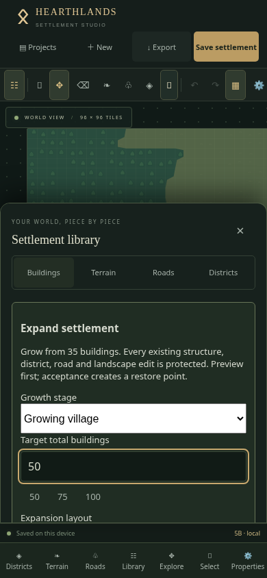
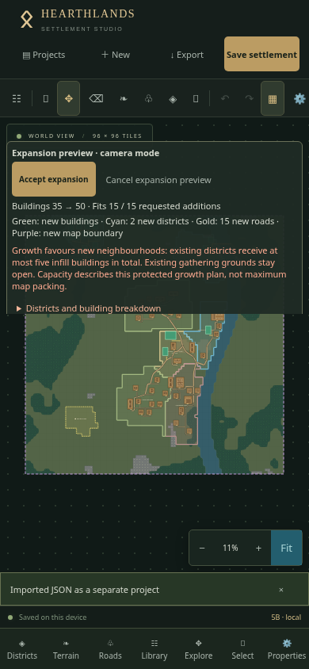
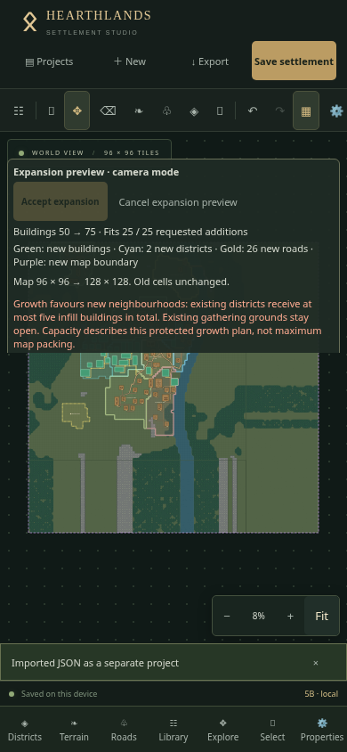
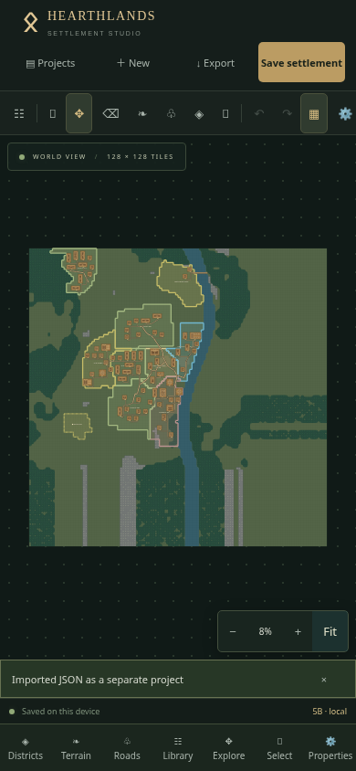
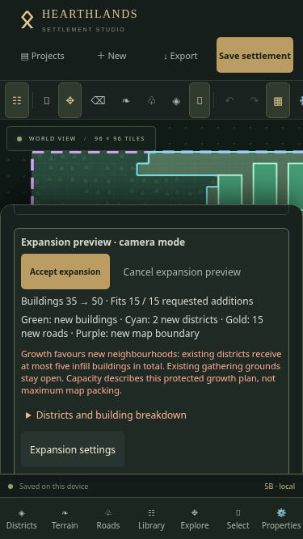
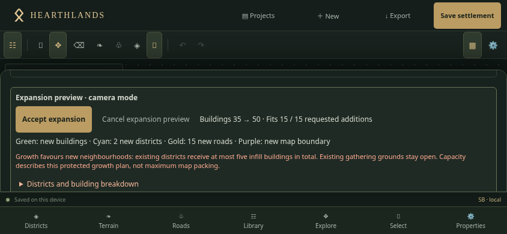

# Phase 5B · Protected settlement expansion

The studio toolbar and Properties panel both expose **Expand settlement**. On a phone, open **Properties → Expand settlement** to see the full named action. The release indicator reads **5B · commit**. Existing New Settlement generation still accepts only 20–60 buildings.

## Implemented

- Growing village, Trading town, Fortified town preparation and Custom expansion; target total up to 100; layout, density, seed, district priorities, new-district and new-road permissions.
- Deterministic, incremental growth using Phase 5A's protected placement and terrain/access validation. With new districts enabled, up to five infill structures are proposed before growing contiguous neighbourhoods on unclaimed accessible land. Trading growth favours commercial development; military preparation proposes catalogue structures, never walls or bridges.
- Existing buildings, roads, bridges, defenses, terrain, landscape overrides, district geometry/metadata, locks, planning and project identity remain unchanged. All original objects are protected, including generated-looking IDs. Locked districts exclude both new buildings and road routing. Existing gate openings may be used without changing them.
- New residential, farming, market, industrial, civic, military or waterfront areas, with directional names. Waterfront/resource priorities influence anchor choice; individual footprints must still satisfy the existing catalogue's resource rules. Gathering and working grounds stay open.
- New primary/secondary routes attach to existing accessible roads; local access paths connect new entrances. Existing road IDs, control points, widths and surfaces are retained. Full-width logical and visual infrastructure is reserved during placement. Invalid water crossings are rejected.
- Optional east/south enlargement up to 192 × 192, previewed in purple and requiring a separate approval checkbox. Old cell arrays and landscape overrides are preserved exactly; new edge terrain is seeded and continues effective boundary material, vegetation, water and elevation. No translation, shrinkage or old-map regeneration.
- Dedicated worker with progress, cancellation and a 60-second timeout. Preview state is separate from the document and autosave. Cyan districts, green additions and gold roads show the proposed changes; Fit includes enlarged boundaries. A count and type summary explains partial proposals.
- Acceptance checks the source and deterministic proposal, validates the complete document, flushes pending saves, creates an automatic restore point, rechecks the source, commits one undo command and flushes autosave. Duplicate/stale acceptance is rejected. Backup failures preserve the original and preview; a final save failure leaves the accepted in-memory state dirty and recoverable through Undo, the backup and Save retry.
- Existing project storage, snapshots, v1/v2/v3 JSON imports, district development, terrain editing, infrastructure, buildings and full-map PNG exports remain in place. Optional provenance version 1 now also accepts `settlement-expansion`; document schema remains v3.

## Verification

Automated coverage includes deterministic Ravenfjord growth, cumulative 35→50→75→100, exact object/terrain preservation, locked claims, closed walls, edited elevations, coastal/forest/medieval constraints, enlargement and confirmation, partial capacity, disabled permissions, source/tamper rejection, backup/storage failures, double acceptance, undo/redo, reopen, JSON and full-map SVG scene content, worker cancellation/stale results/deadline. Full regression suite and production build results are recorded in the delivery report.

Benchmarks use a 35-building seed-1847 Viking riverside source with target 100. Local Node timings are logged by the test suite for 96², 128² and 192² maps; they are desktop measurements, not iPhone timings. Searches are capped at 16 candidate neighbourhoods and 100 total buildings. Generation runs in the worker; acceptance repeats deterministic validation synchronously before the storage transaction.

Production Chromium touch emulation verifies 390 × 844: import a separate 35-building fixture, cancel unchanged, regenerate/accept 50, exact Undo/Redo, enlarge to 128² and accept 75 with explicit confirmation, two automatic snapshots, complete JSON and 2048-pixel PNG downloads, separate JSON import, and persistence through closing/reopening the browser profile. Portrait 375 × 667 / 390 × 844 and landscape 667 × 375 / 844 × 390 verify inline-sheet approval/cancel controls, independent scrolling, no horizontal overflow and retained district-development selection. Real two-finger CDP touch gestures during preview preserve document data. Physical Safari is not available in this environment.

## Physical iPhone acceptance

1. Open the deployed app, reload and check the footer says **5B** with the delivered commit. A fresh `?release=5B` URL can help distinguish browser caching. **Do not clear website data**: settlements live in IndexedDB on this device.
2. In Projects, duplicate Ravenfjord and open the copy. Export a baseline JSON. Verify it has 35 buildings; keep the original project untouched.
3. Open **Properties → Expand settlement**. Choose Growing village, target 50, contextual, balanced, seed 1847, allow districts and roads. Keep dimensions 96 × 96. Generate preview. Pinch and drag the map, open Expansion settings, scroll the summary and cancel. Export again: the document must be identical to the baseline.
4. Regenerate with identical settings: new positions, IDs, neighbourhoods and paths must match. Accept expansion. Wait for **Saved on this device**. Inspect new districts and entrances. Existing buildings, bridge banks, roads and terrain must remain in place.
5. In Projects → Restore points, check **Automatic backup before settlement expansion**. Undo once restores the full original; Redo restores the full expansion. Reopen the wizard after Redo.
6. In Districts, select Harbour, lock it and save. Propose target 75; inspect that no green building or gold path enters the locked district. Cancel, or accept a valid smaller proposal if capacity is limited. Existing district boundaries must not change.
7. For enlargement, set width and height to 128 in Optional east / south map enlargement. Generate; Fit shows added terrain and purple boundary. Accept stays disabled until the separate enlargement checkbox is checked. Approve, then verify old objects retain coordinates.
8. Propose 100 buildings with Trading town. Inspect the commercial/residential mix, count and limitations. A smaller valid offer is expected when terrain, claims, roads or defenses block capacity. Nothing may force a water crossing or remove a wall. Cancel and retry another seed if desired.
9. Close Safari and reopen the same project. Check accepted counts, terrain, districts and provenance persist; restore points remain available. Try moving/rotating a new building and undoing that edit; ordinary tools must still work.
10. Export JSON, import it as a separate project and compare all geometry/data (only project identity changes). Prepare a complete 2048 PNG with districts on, tap Download, then inspect it in Files. Repeat with districts off. Enlarged terrain, original infrastructure and new neighbourhoods must all appear.

## Limits

- Capacity is the result of bounded, conservative growth planning, not exhaustive maximum packing. New-neighbourhood planning favours short reachable routes and mixed roles; it does not simulate economics or population. No existing district boundary expansion is performed.
- Connecting routes use grid navigation with safe visual rounding where possible. Dense/irregular claims, forest, cliffs, waterways and defenses can require manual clearing, a gate or bridge before further growth. No new bridges or defenses are built automatically.
- Enlargement continues nearest-edge terrain with seeded vegetation breaks. Rivers/coasts outside the old map are simple continuations, not a fresh landscape simulation. Old sculpting is never recomputed.
- The 100-building and 192-tile limits remain. Acceptance validation can briefly occupy the main thread; physical iPhone performance and Safari download behaviour need the steps above. Browser storage can still fail or be cleared externally: export portable backups.

## Screenshots

## Delivery measurements

- Complete suite: **187 tests passed in 16 files** (103.08 seconds on this workspace).
- `npm run build` and `npm run verify:release`: passed. Vite retains its bundle-size advisory (approximately 854 kB main bundle, 268 kB gzip); no build errors.
- Target 100, source 35 buildings, dense trading growth, seed 1847:

| Map | Expansion time | Result | New districts |
| --- | ---: | ---: | ---: |
| 96 × 96 | 1,551 ms | 100 buildings | 7 |
| 128 × 128 | 1,702 ms | 100 buildings | 7 |
| 192 × 192 | 2,167 ms | 100 buildings | 7 |

These measurements include pure planning/placement, not project storage or PNG encoding; browser validation was also running on the machine. Other seed/terrain combinations can return fewer buildings. The Phase 5A production flow was rerun against the Phase 5B bundle: fill five, explicitly replace two, cancel, preserve other objects, undo/redo, restore points, JSON/PNG, separate import and reload all passed. Its initial screenshot helper attempted to tap Fit behind the open library; closing the library before the map action corrected the test harness.
