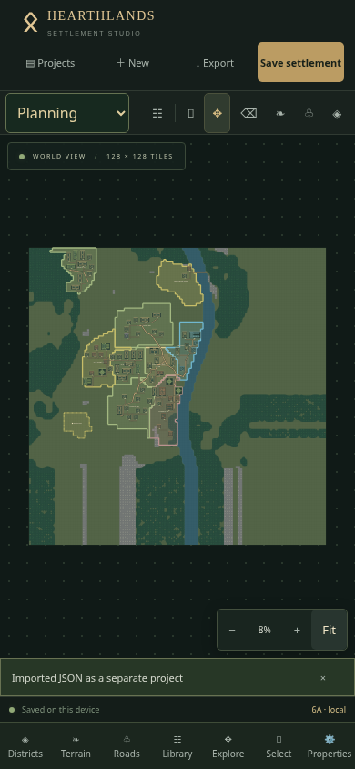
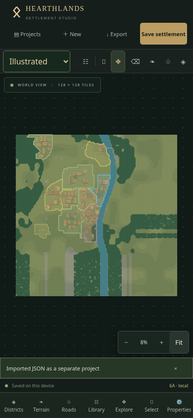
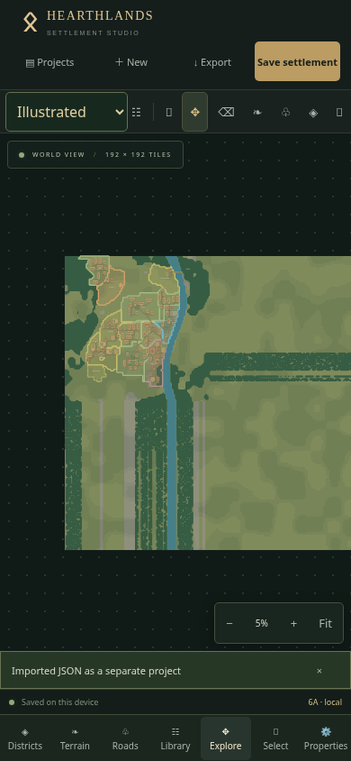
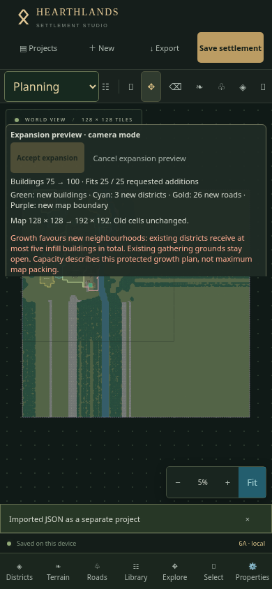
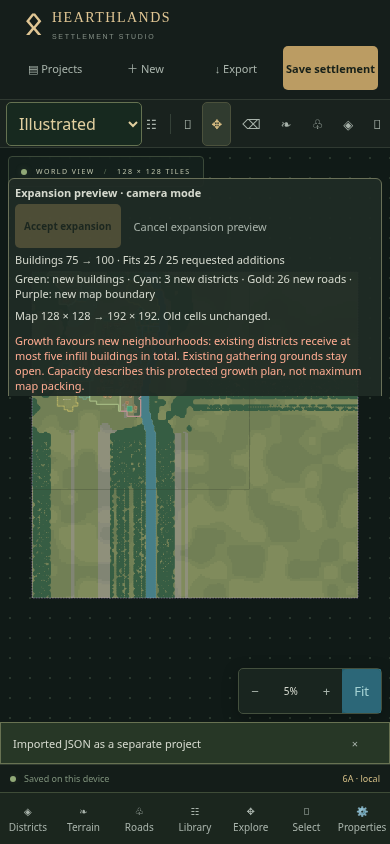
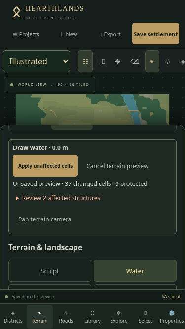

# Phase 6A · Planning and Illustrated rendering

Use **Map style** at the left of the studio toolbar, or **Properties → Map style settings**. The current style, detail preference and optional building names are saved as versioned user preferences in this browser, shared across projects. They restore on browser restart. They never enter settlement documents, autosave revisions, generation settings, snapshots or undo history. Existing v1/v2/v3 project files remain unchanged.

## Presentation layers and shared inputs

- `rendering/styles.ts` defines style types, category palettes, building presentation hooks, detail thresholds, cache buckets and compositional layer order.
- `rendering/terrainGeometry.ts` produces tagged base / nature / water / relief vector batches from the existing terrain queries. `scene.ts` orders them and caches up to four presentation variants. The scene does not use camera position or mutate documents.
- `TerrainVisual.tsx` draws cached native `Path2D` vectors, avoiding costly JavaScript curve-length parsing. At overview zoom it uses a disposable, explicitly bounded bitmap cache (at most 2048 pixels per edge). Close zoom keeps vectors. No bitmap is stored in projects or used for full-map exports. Native path entries are weakly held; a Konva vector fallback remains available.
- `InfrastructureVisual.tsx` memoises material strokes over the unchanged road geometry. Roads render below bridges and defenses. Editor hit widths, IDs and editing controls remain independent from appearance.
- `BuildingVisual.tsx` is a memoised, non-interactive presentation component. Shared `buildingPresentation` supplies category accents, roof tones, outlines, lock marks and optional shading to both canvas and PNG output. Existing original top-down symbols remain the building-art hook; no final building-specific art pack was added.
- Districts, empty decorations placeholder, optional building labels and interaction/proposal layers compose above the landscape. Selection, lock marks, terrain conflicts, control handles, additions/removals and confirmations retain explicit high-contrast treatment. Their logic never depends on the active style.
- Full-map SVG/PNG uses the same terrain scene, building presentation, road geometry and infrastructure strokes. It retains complete world bounds and independent grid / label / district / district-name options.

## Styles

**Planning** uses clean category accents, contrasting silhouettes, readable entrances/locks, crisp material outlines and road hierarchy. Water, woodland, rock, cultivated soil, contours and cliffs keep their meaning.

**Illustrated** adds warmer ground, coherent seeded tonal variation, softer shore strokes, richer water/woodland, subtle waves and vegetation depth, restrained road detail and generic building shading. These are visual additions over the same settlement. They do not clear forest, move water banks, round road control points or change footprints.

Illustrated automatically removes small texture marks below seven screen pixels per tile. **Properties → Visual detail → Reduced** provides an explicit lighter path for either style. Coverage, contours, infrastructure, entrances, lock signals and editing overlays remain. Fine detail returns when zooming in with Automatic selected.

## Exports and persistence

Open Export & import → Complete map PNG. **PNG style** initially follows the studio style and can independently select Planning or Illustrated. Choose resolution, reduced detail, grid, building names, contours, terrain detail, district overlays and district names. Changing any export option invalidates a prepared download. PNG filenames include the style. Exports use full-map vectors, independent of the viewport and overview bitmap cache.

User preferences use `hearthlands.visual.v1` in localStorage. Invalid or unsupported preferences safely default to Planning. If writes are blocked, the style still applies for the session and a message explains that it could not be saved. Project storage and recovery are unaffected. JSON exports intentionally contain the settlement rather than browser-wide visual preferences.

## Validation and performance

Automated coverage verifies style persistence, corrupt/blocked preferences, exact document/history/save-revision preservation, deterministic cached scene construction, layer order, category and lock presentation, native path reuse/fallback, low-zoom detail reduction, style-correct exports and independent visibility toggles. The complete existing editor, generator, expansion, infrastructure, terrain, district, persistence and export suites remain enabled.

A production Chromium touch run at 390 × 844 verified a 75-building project in both styles, exact unchanged document and save revision on switching, building hit selection, two different complete 2048 PNG downloads, unchanged project JSON, style switching during a 75→100 expansion preview with 192² enlargement, accepted growth, pan gestures and style/document persistence through a real browser-process restart.

For a 100-building, 192 × 192 overview, a 90-frame local sample in each style measured:

| Style | Median frame interval | 95th percentile | Worst sampled frame | Style selection |
| --- | ---: | ---: | ---: | ---: |
| Planning | 16.7 ms | 16.8 ms | 33.3 ms | 116 ms |
| Illustrated (automatic reduced detail) | 16.7 ms | 16.8 ms | 33.4 ms | 96 ms |

These are Chromium emulation measurements on the workspace, not physical iPhone promises. Native path drawing and the overview cache fixed an earlier large-preview stall; exports always remain vector-based. At device pixel ratio 3, both styles again had a 16.7 ms median, with 33.4 ms at the 95th percentile and worst sampled frame. Cold 192² scene construction measured about 64–159 ms locally; 50 cache lookups took 0.9–1.9 ms.

The complete suite passed **195 tests in 17 files** (97.25 seconds). Production build and release verification passed; Vite retains its existing bundle-size advisory (about 863 kB main JavaScript, 271 kB gzip). Both styles passed the complete production touch regression at 375 × 667, 390 × 844, 667 × 375 and 844 × 390: independent panel scrolling, selected/locked district development, preview cancellation, polygon editing, terrain conflict confirmation and road draft controls, with no page errors or horizontal overflow. The synthetic pinch test now waits for browser gesture completion before tapping Resume; an earlier too-fast harness tap did not resume editing.

## Physical iPhone verification

1. Reload the deployed application and check the footer says **6A** and the delivered commit. If needed, open a fresh `?release=6A` URL. **Do not clear website data**: that would erase local settlements.
2. In Projects, duplicate Ravenfjord and open the copy. Save and export a baseline JSON. Select Planning from the toolbar dropdown; use Explore and Fit.
3. Switch to Illustrated, then back to Planning. Compare every building, entrance, road, bridge bank, terrain edit and district boundary. No object may move. The save indicator should remain Saved; switching does not add an Undo step. Export JSON again and compare it to the baseline.
4. In each style, choose Select, tap a building, open Properties and inspect its name/coordinates/footprint. Move or rotate it, then Undo. Check a locked building remains visibly marked and cannot move accidentally.
5. Open Roads. Select a road and its points, draw a short draft and cancel it. Check bridge rails, gate marks and defense selection stay readable in both styles. Two fingers must still pan/zoom.
6. Open Terrain. Try a water stroke over a protected building or bridge bank. Inspect the conflict preview and Cancel. Try a ground/forest brush outside the village, Undo it and confirm the original landscape returns. Repeat in the other style.
7. Open Districts, select a district, show/hide its overlay, then draw a triangle or extend cells. Review its boundary and Cancel. Confirm district and development actions appear inside an open mobile sheet, not over it.
8. Open Properties → Visual detail. Select Reduced and pan/zoom. Return to Automatic; Illustrated should show more fine vegetation/water detail when zoomed in, and simplify at overview scale. Toggle building names without moving anything.
9. Open Export & import. Choose Planning PNG, 2048 pixels, labels/grid/district options as desired; Prepare and Download. Choose Illustrated and prepare/download again. Inspect both in Files: colours and presentation differ, complete map bounds and all geometry match. Repeat with labels/grid/districts off.
10. Open a 75–100-building project. Fit, pan with one finger in Explore and pinch with two. Check that controls respond, previews remain visible and zooming never paints. Use Reduced if needed on the device.
11. In Expand settlement, generate a preview. Switch Planning ↔ Illustrated while inspecting additions. Pan/pinch and confirm the same proposed objects/count remain. Cancel: no data changes. Regenerate and accept only if desired; verify the automatic restore point and single-command Undo/Redo still work.
12. Leave Illustrated selected, close Safari and reopen the same site/project. Confirm style and accepted edits persist. Open another project: the chosen browser-wide style remains. Restore a snapshot and import a JSON as a separate project; geometry must restore without resetting user visual preferences.

## Limits

This is the style-engine foundation, not the final art overhaul. It reuses the current original building symbols and adds generic presentation hooks. No decoration system, animated water, remote textures, AI services or new geometry generation is introduced. Existing terrain continuation from map enlargement can still look linear; visual styling does not regenerate it.

At very close zoom, large vector maps can cost more than cached overview rendering. Cache resolution is bounded for memory safety; full-map PNG remains crisp and independent of that cache. Older engines without Path2D use the slower vector fallback. High-resolution PNG memory errors retain the existing safe error handling. Physical Safari, safe-area behaviour with a real keyboard and device thermal/performance limits require the steps above.

## Visual comparison

