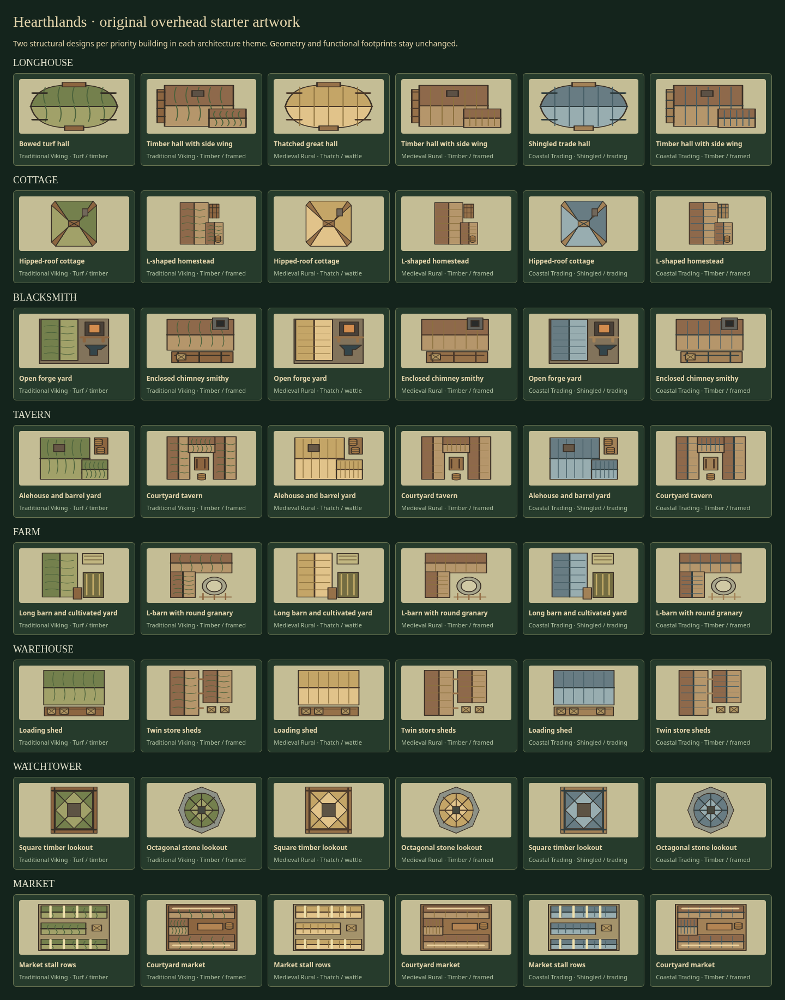
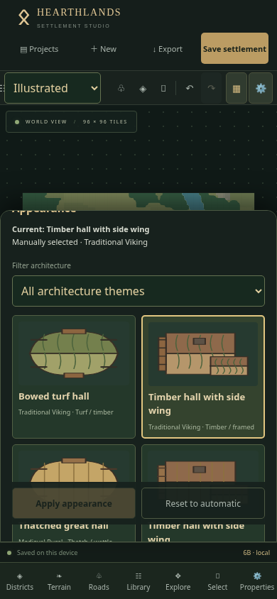
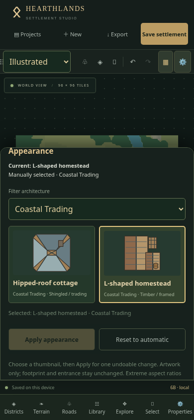
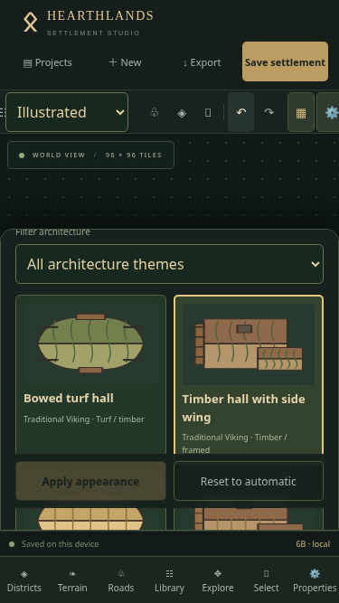
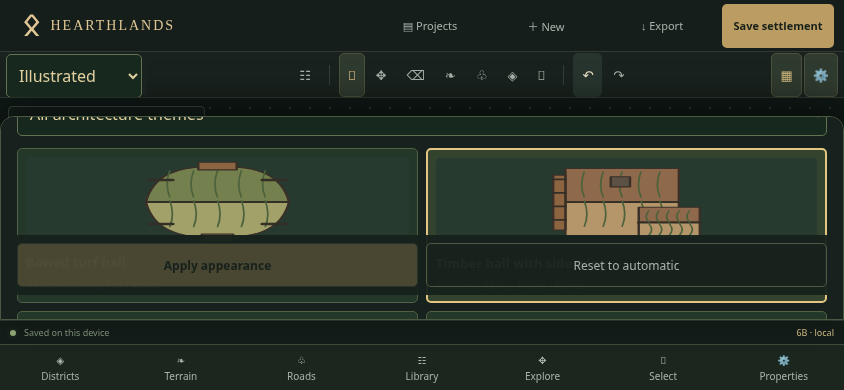
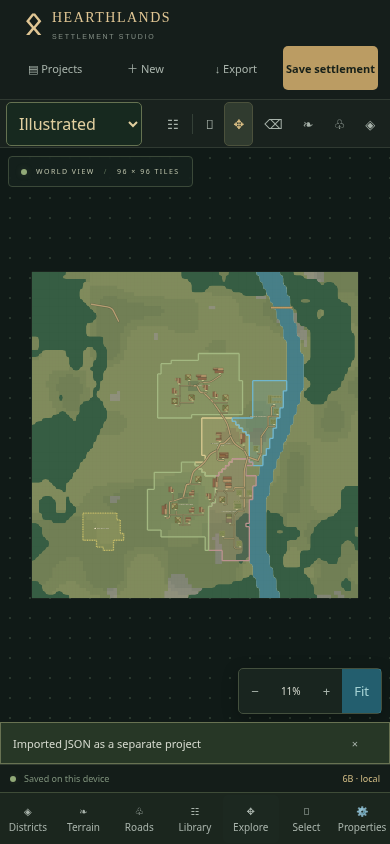
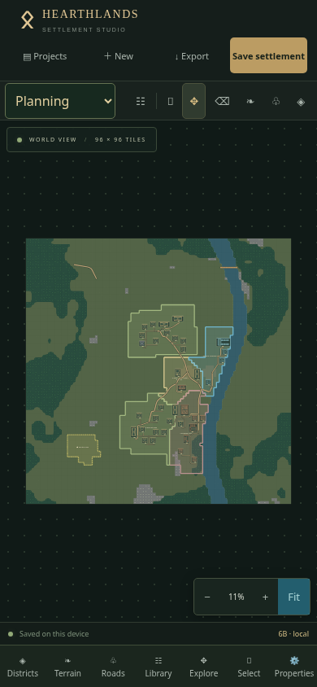
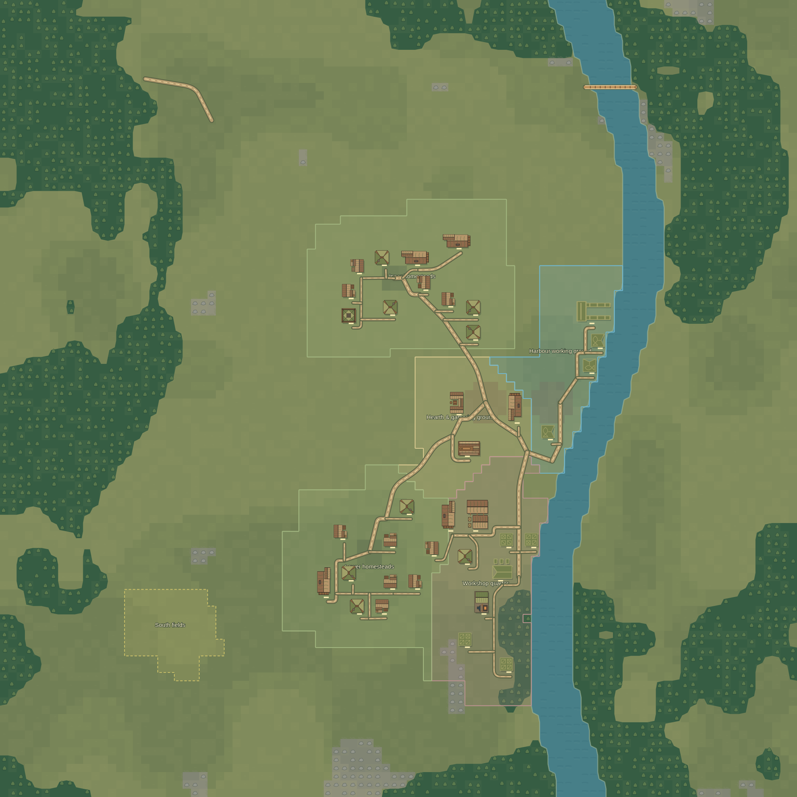
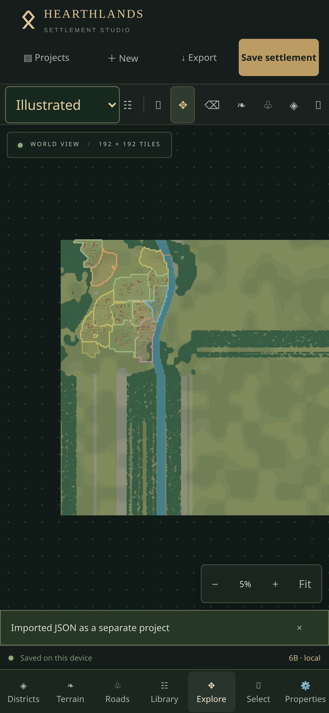
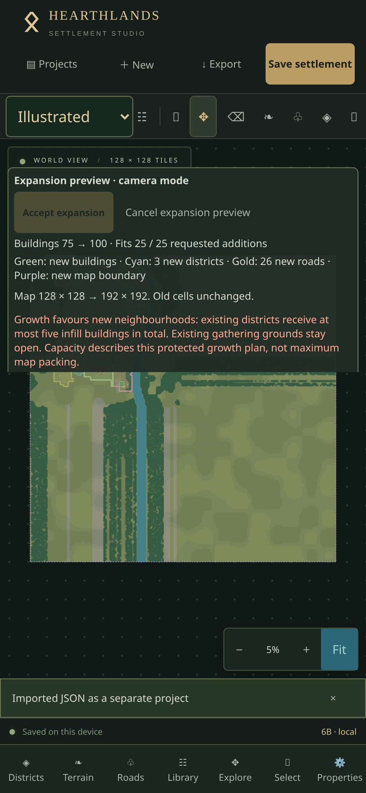

# Phase 6B · Building asset catalogue

Properties → Appearance now provides illustrated building variations. Architecture themes are saved per settlement in Properties → Settlement architecture. Planning / Illustrated remains the separate, browser-wide Phase 6A style preference.

## Starter artwork

The local registry contains **81 entries**:

- **48 illustrated entries** for longhouses, cottages, blacksmiths, taverns, farms/barns, warehouses, watchtowers and markets: two structurally different designs in each of three themes.
- **33 themed symbol fallbacks** for the other eleven functional kinds. These retain useful original plans; they are not advertised as new structural variants.

There are sixteen priority structural designs, with three themed material treatments. Examples include a bowed turf hall versus a timber hall with a side wing; a hipped cottage versus an L-shaped homestead; an open forge yard versus an enclosed chimney smithy; an alehouse versus a courtyard tavern; a long barn versus an L-barn/granary; a loading shed versus twin stores; a square timber lookout versus an octagonal stone lookout; and stall rows versus a courtyard market.

The artwork is original, strict overhead vector composition with roof planes, ridge lines, material marks, chimneys, working areas and building-specific details. It contains no generated images, paid assets, remote textures or runtime image services. Crates, barrels and yard details are parts of building artwork, not a new decoration system.

## Architecture and deterministic assignment

Themes are **Traditional Viking**, **Medieval Rural** and **Coastal Trading**. Legacy documents without architecture metadata default to Traditional Viking without rewriting their buildings. Newly generated medieval settlements default to Rural; coastal environments default to Coastal Trading; other Viking presets default to Traditional Viking.

Automatic selection uses rendezvous hashing of settlement seed, functional kind, persistent building ID and eligible asset ID. It does not consume generation randomness or use coordinates, rotation, footprint, array order, camera or zoom. Moving, rotating or resizing preserves the selected automatic asset. A theme changes the eligible asset pool. Explicitly changing the settlement seed may change automatic choices.

Manual choices always retain their asset ID across theme changes. Locked buildings cannot receive individual appearance edits. When the theme changes, locked automatic looks are pinned in architecture metadata without changing those building objects. Unlocking releases the pin and adopts the current automatic theme. Duplicating a manual building preserves its selected appearance; an automatic duplicate has a new persistent ID and may receive another deterministic variation.

New Phase 5A / 5B buildings resolve their artwork from the same inputs in preview and after acceptance. All existing building IDs and metadata remain protected. New art assignments do not need per-building writes unless the user chooses a manual override.

## Model and renderer boundaries

- `model/catalogue.ts` still defines functional kinds and default footprints.
- `assets/buildings/types.ts`, `artwork.ts` and `registry.ts` define typed visual manifests, reusable compositions, theme eligibility, stable IDs, names, thumbnails, footprint/aspect rules and canonical orientation.
- `model/appearance.ts` resolves choices and implements pure appearance/theme operations. Optional version-1 metadata is additive within document v3: `building.appearance` and `document.architecture`.
- `rendering/buildingArtwork.ts` provides shared asset paths, silhouettes and local footprint transforms. `ArtworkVisual.tsx` reuses native Path2D parsing across buildings; the editor, thumbnail and SVG/PNG exporter consume the same registry geometry.
- `BuildingVisual.tsx` displays assets only in Illustrated mode. Planning preserves clean architectural symbols. Artwork rotates about the world footprint centre and scales inside local building axes. Extreme aspect ratios contain the artwork at its nominal aspect rather than changing collision dimensions.
- Selection hit regions, collision warnings, entrance indicators, lock marks and proposal colours remain separate interaction overlays. The existing navigation entrance indicator remains authoritative (the current model uses a world-south approach); artwork does not create new entrances or rotate the navigation model.
- At low zoom, fine marks and small structural details are omitted in favour of roof masses and major ridges. Native vector-path caching and the Phase 6A terrain overview cache remain independent of document state.

A manual override is `{ "version": 1, "mode": "manual", "assetId": "starter.viking.longhouse.2" }`. Absence of appearance metadata means Automatic; Reset removes the override. Known assets with the wrong functional kind are rejected. Unknown, safely named future asset IDs are retained on import and shown with an automatic fallback and a visible inspector message. Unsupported metadata versions, unsafe IDs and invalid pinned references are rejected safely.

## Mobile controls and recovery

Choose a thumbnail, then **Apply appearance** for one immediate, undoable document change. The current and pending choices are labelled separately. **Reset to automatic** is also one command. Filter by architecture or show all compatible art; manual selection can cross architecture themes intentionally. The thumbnail grid and action area scroll inside Properties; the bottom navigation returns to the map without camera movement from thumbnail taps.

Architecture is a project setting, unlike the Phase 6A map-style preference. It and manual appearances participate in autosave, project duplication, snapshots, Undo/Redo and JSON exports. Restoring a snapshot restores its theme and choices. A development/expansion proposal must be finished or cancelled before editing appearance metadata, so approval cannot accidentally use a stale source.

Full-map Illustrated PNG uses the same asset paths, transforms, shading and detail rules as the editor. Planning PNG continues to use planning symbols. PNG preparation remains independent of viewport pan/zoom, with existing grid, labels and district controls. No new project schema or IndexedDB version is required.

## Future Midjourney / image-pack preparation

Image-pack import is **not implemented**. The manifest types include a future bundled-image contract with a local source, MIME type, pixel dimensions and vector fallback. Current installed assets are vectors. A future image renderer and explicitly approved local pack loader can extend that contract without changing functional building kinds, editor geometry or appearance IDs.

Recommended source requirements:

1. **Direct overhead / orthographic**, with no visible side perspective, horizon, lens distortion or isometric projection. Keep roofs and walls consistent across the pack.
2. **True transparent background**, cleaned manually around roofs and eaves. Remove ground planes, unwanted trees, text, logos and stray shadows. Do not rely on a painted checkerboard to represent alpha.
3. **Consistent lighting**: restrained light from the upper left, with shadows towards the lower right. Avoid baked dramatic shadows that imply extra collision area. Keep the artwork inside its mapped footprint and padding.
4. Start around **1024–2048 pixels** on the long edge, using lossless RGBA PNG. Match rectangular source dimensions to the nominal footprint where practical (for example 1024 × 512 for a 4 × 2 longhouse). Keep 2–6% transparent padding. Oversized images must be bounded/downsampled before installation.
5. Supply a stable namespaced asset ID, compatible functional kind, architecture theme, variation name, nominal footprint, aspect limits, canonical orientation and automatic eligibility. Use the existing kind catalogue; visual packs must not invent collision geometry.
6. Canonical zero rotation is north-up in local building coordinates. Rotate about the centre in 90-degree steps; never rotate the saved settlement coordinates. Avoid painted entrance arrows: use the editor's authoritative entrance marker.
7. Derive 128–256 pixel thumbnails from the cleaned source using the same aspect mapping, then inspect them against light and dark backgrounds. Thumbnails must depict the installed artwork, not an unrelated crop.
8. Bundle only trusted local files using Vite's base-aware asset pipeline. A future loader must reject remote URLs/path traversal, validate MIME/dimensions and resource budgets, sanitise SVG scripts/foreign objects/external references, and preserve transparent alpha.
9. Full-map export must embed approved image data in the SVG/PNG preparation pipeline rather than depend on network URLs, fonts or cross-origin resources. Portable image packs need explicit bundling/licensing rules; JSON currently stores asset IDs rather than artwork bytes.
10. Activate future packs explicitly. Do not rename existing IDs or silently make new assets eligible for old automatic pools without a deliberate compatibility policy.

Arbitrary Midjourney output will not work reliably without perspective correction, background cleanup, consistent lighting, footprint mapping and export validation. This phase does not promise an upload-and-use workflow.

## Physical iPhone acceptance

1. Reload the deployed app and verify footer **6B** with the delivered commit. If needed, use a fresh `?release=6B` URL. **Do not clear website data**, which would remove local projects.
2. In Projects, duplicate Ravenfjord and open the copy. Export a baseline JSON. Switch the toolbar's Map style to Illustrated, then Explore → Fit.
3. Select a longhouse and open Properties. Scroll to **Appearance**. Confirm six compatible thumbnails, with two different roof plans in each architecture. Filter to Traditional Viking and compare the bowed turf hall with the timber side-wing hall.
4. Choose the other roof, tap **Apply appearance**, wait for Saved and inspect the map. No position, footprint, road, bridge, terrain or district may move. One Undo must restore the previous appearance; Redo must restore the chosen one.
5. Select another building, choose a different theme/variation and Apply. Scroll below the selected-building inspector to **Settlement architecture → Architecture theme**. Select Medieval Rural, then Traditional Viking. Automatic buildings should use compatible assets; both manual choices must remain.
6. Lock a selected building and confirm its thumbnail Apply/Reset controls are disabled. For an automatic locked building, change the settlement theme: its current look must remain fixed. Unlock it and confirm the current theme's automatic appearance resumes.
7. Move, rotate and resize an unlocked building. Its chosen asset must remain stable and rotate/scale with it; selection and the entrance marker must stay correct. Undo the geometry edits. Extreme aspect ratios may show contained artwork while the logical footprint remains unchanged.
8. Tap Reset to automatic and verify it adopts the current theme. Undo to restore the manual choice. Duplicate the manually configured building and confirm the copy keeps the selected asset. Undo the duplicate if it creates a collision warning.
9. In Projects → Restore points, create a named point for the chosen artwork. Change one appearance, then restore the point with confirmation. Inspect that theme, choices and all geometry return correctly.
10. Use Districts → Develop district to add compatible homes, or preview expansion. Check new roofs are consistent and varied, existing manual choices stay fixed, green/red preview colours stay clear, and Cancel saves nothing. Accept only a wanted proposal; test Undo/Redo.
11. Open a 75–100-building map, Fit, pan and pinch. Inspect roofs at overview and closer zoom. Properties → Visual detail → Reduced provides an explicit lighter path. Thumbnail browsing must scroll independently and must not pan the map.
12. Export JSON and a complete 2048 Illustrated PNG. Open the PNG in Files and inspect roof forms, rotations and full map bounds. Import JSON as a separate project; only project identity changes. Close Safari, reopen the project and confirm theme/manual choices persist.
13. Switch to Planning. Its symbols, selection, resize/rotate, terrain, infrastructure and district editing must remain clear. Return to Illustrated and confirm choices are unchanged.

## Visual comparison

## Limits

This is a useful local starter catalogue, not the final art pass. Priority types have two structural plans per theme; the other eleven kinds retain original-symbol fallbacks. Automatic variation can repeat, especially in a village dominated by one kind. Image-pack import, image rendering/bundling, custom uploads, environmental assets and independent decorations remain future work. Artwork does not change navigation or automatically infer new entrance positions. Physical iPhone Safari must be verified using the steps above; Chromium touch emulation cannot prove device-specific performance or download behaviour.

## Validation results

- Full suite: **209 tests across 20 files passed**; production build and release verification passed. Vite retains its existing large-chunk advisory (880 kB main bundle, 277 kB gzip).
- Production Chromium touch checks passed at 375×667, 390×844 and 844×390: thumbnail selection, independent scrolling, geometry preservation, locks, theme changes, undo/redo, reset, restore points, autosave, browser restart, separate JSON import and complete 2048-pixel PNG download. No page errors or horizontal overflow were observed.
- Actual district development and expansion previews/acceptance were exercised, including 75→100 buildings and a 192×192 map, switching both styles without changing existing objects.
- A DPR-3 Chromium pan/zoom sample on 100 buildings / 192×192 measured approximately 16.7 ms median and 33.4 ms 95th-percentile frames in either style, with occasional 83 ms frames. These workspace measurements are not a physical-iPhone performance guarantee. Automatic selection for 100 buildings over 51 passes took approximately 11 ms total.
- Physical iPhone Safari testing remains outstanding; use the acceptance steps above, especially Files downloads and Safari reopening.

