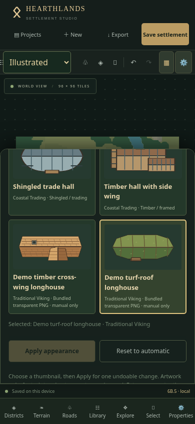
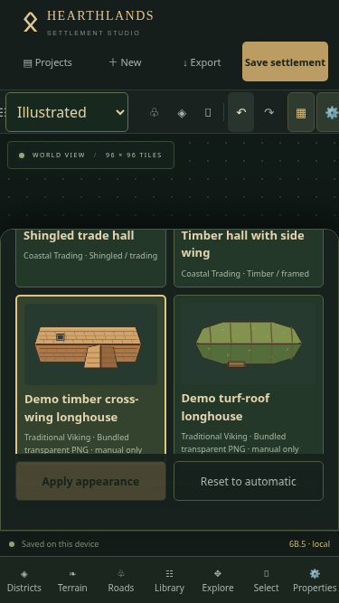
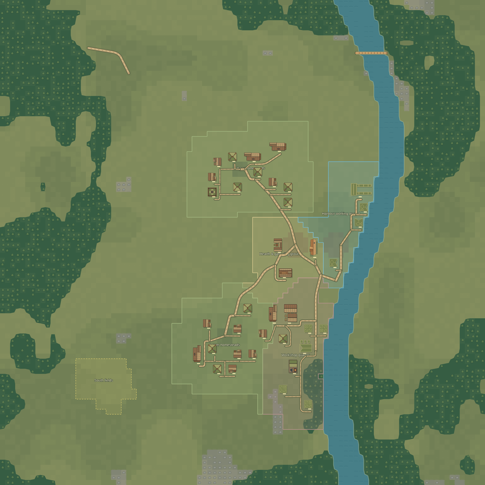
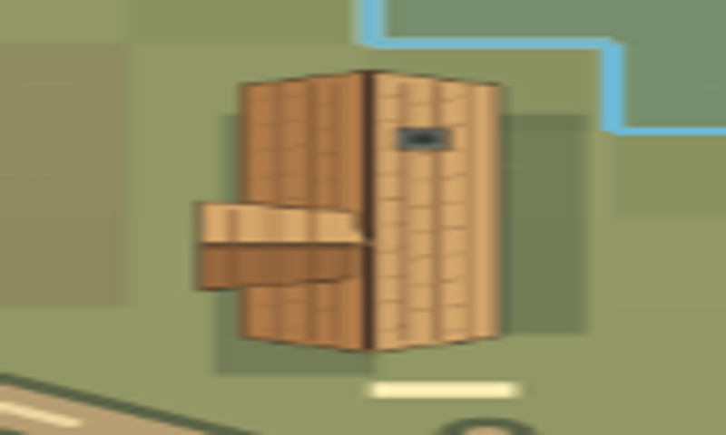
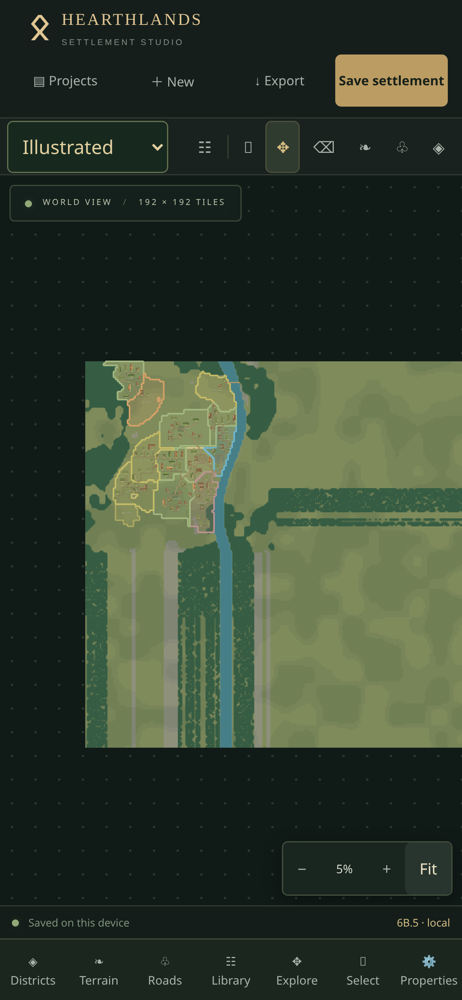

# Phase 6B.5 — Installed transparent building PNGs

Current raster sizing/shadows and optional alpha-bound authoring: [Phase 6B.6](phase6b6-raster-alignment.md). Raster pixels now always preserve their native proportions; the earlier fallback-coordinate fitting described below is superseded.

The 81 existing vector entries and their automatic-selection pools are unchanged. Two **manual-only** Traditional Viking longhouse entries demonstrate original transparent raster artwork:

- `demo.viking.longhouse.timber` — shingled timber gable with a structural cross-wing and chimney.
- `demo.viking.longhouse.turf` — bowed turf roof, timber ribs and side vestibule.

Both are 1024×512 RGBA PNGs with genuinely transparent backgrounds. They are temporary original Hearthlands artwork, not Midjourney output or final commissioned assets. `scripts/create-demo-buildings.py` reproduces them with optional Python/Pillow authoring tooling; Pillow is **not** needed by npm install, build, tests, deployment or the application.

## Supported pipeline

The typed registry accepts vectors and approved PNGs. Each image carries a stable ID, functional kind, architecture, variation, static source reference, intrinsic pixel dimensions, nominal footprint/aspect limits, canonical orientation, vector fallback and automatic-selection flag. The same PNG bytes feed thumbnails, Konva buildings and self-contained full-map SVG/PNG exports. Image decoding and 256-pixel overview surfaces are cached per installed source. Missing/unapproved references, decode failures, incorrect intrinsic dimensions and a five-second load timeout use vector fallbacks; the project's selected ID remains intact. Reloading retries a failed decode.

Appearance does not change collision geometry, navigation entrances, rotation semantics, terrain, roads, districts or object IDs. Planning is unchanged. Autosave, snapshots, undo/redo, duplication and JSON store the **asset ID only**, never image blobs. A recipient needs a Hearthlands release with that asset installed to see it; otherwise normal unknown-ID fallback applies.

Vite `?inline` imports embed trusted PNG data URLs in the compiled application. This is safe for `/Hearthlands/` on GitHub Pages and needs no runtime image request, CORS exception or paid service. PNG export embeds these same approved bytes inside its intermediate SVG, avoiding external references and tainted canvases. Existing 1024/2048/4096 size limits and grid/label/district choices remain. Use 1024 or 2048 on memory-constrained phones; allocation/encoding failures show the existing error without changing the document. The SVG builder is an internal export function; no new SVG download UI is added.

This supports **installed/bundled PNG files**, not arbitrary runtime uploads, asset-sheet import, remote image URLs, WebP or user-installed packs. Do not clear Safari website data to refresh a release: it contains local projects.

## Install your first real Midjourney building

1. Supply a single isolated **direct-overhead/orthographic** longhouse, not an isometric scene or perspective view. Remove all background, ground, trees, cast shadows extending beyond the building and unwanted neighbouring structures. Keep consistent neutral lighting. Confirm the right to use/distribute the image.
2. Deliver a cleaned **RGBA PNG** with transparent alpha, preferably **1024×512** for a 4×2-tile longhouse (or up to 2048×1024 for sharper large exports). Use the building's nominal footprint ratio. Leave approximately 5–10% transparent padding on every edge; no opaque white matte. Visible roof pixels must not touch the canvas boundary. Arbitrary Midjourney output usually needs perspective correction, masking and cleanup first.
3. Use the same orientation as the demo: long axis east–west, vestibule/visual entrance toward map south at rotation 0. Artwork rotates around the footprint centre. The existing logical entrance remains south-facing according to editor rules; artwork never changes pathfinding. Check all four rotations before approval.
4. Save it as `src/assets/buildings/png/ravenfjord-viking-longhouse-01.png`. Filenames and source keys must use lowercase letters, digits and hyphens. Never replace an installed asset's artwork under the same ID without an explicit compatibility decision.
5. Add its static import and closed-map entry in `src/assets/buildings/images.ts`:

   ```ts
   import ravenfjordHall from './png/ravenfjord-viking-longhouse-01.png?inline';
   // Inside installedImages:
   'buildings/ravenfjord-viking-longhouse-01.png': ravenfjordHall,
   ```

6. Add this entry to a new explicit image collection in `src/assets/buildings/registry.ts`, then append that collection to `buildingAssets`. Reuse a compatible approved vector fallback:

   ```ts
   const ravenfjordHall: BuildingAsset = {
     id: 'ravenfjord.viking.longhouse.01',
     kind: 'longhouse', name: 'Ravenfjord timber hall', theme: 'viking',
     variation: 'Cleaned overhead timber roof',
     artwork: {
       format: 'bundled-image',
       source: 'buildings/ravenfjord-viking-longhouse-01.png',
       mime: 'image/png', pixelWidth: 1024, pixelHeight: 512,
       fallback: starterPack.assets.find(a => a.id === 'starter.viking.longhouse.2')!
         .artwork as VectorArtwork,
     },
     thumbnail: {view: 'artwork', background: '#263a30'},
     footprint: {nominal: [4, 2], aspectRange: [1.6, 2.4], fit: 'adapt-or-contain'},
     canonicalOrientation: 0, automatic: false,
   };
   ```

   Import `VectorArtwork` from `./types` for the example. Match declared dimensions to the actual PNG. The validator permits integer dimensions from 32 to 4096 and at most 8,388,608 pixels, rejects remote/absolute/traversal/encoded/query references and non-PNG formats, and requires an approved installed mapping plus a valid vector fallback. The fallback viewBox supplies the shared coordinate space; the full PNG rectangle maps into it. Outside the allowed aspect range, the nominal aspect is contained within the footprint.
7. **No separate thumbnail is needed**: `thumbnail.view: 'artwork'` uses the exact installed PNG. Compare its alpha edges against the dark green thumbnail background and actual grass/water. Ensure both complete and reduced-detail renderings remain recognisable.
8. Add registry/PNG/header/dimension and export tests for the new ID. Run `npm test`, `npm run build`, `npm run verify:release`, then `npm run dev` or a production Vite preview. In Illustrated → selected longhouse → Properties → Appearance, choose the new thumbnail and Apply. Test move/rotate/resize, locks, reset/undo, reopen, JSON and complete PNG at 1024/2048/4096. Do not make a permanent selection on your only copy of a project while testing.
9. Keep `automatic: false` until reviewed. Setting it to true deliberately changes the eligible pool and can change **existing automatic buildings'** appearance, even though their geometry stays fixed. Review that visual compatibility policy explicitly; never activate new entries merely because files were installed. Existing manual choices remain stable.
10. Record the artist/source, creation date, licence or usage permission, attribution text, editing history and redistribution/export rights alongside the pack's documentation. Commit the approved PNG, mapping, registry entry, attribution and tests; deploy using the normal workflow. A JSON file alone does not transport the image.

For the first real asset, provide: the cleaned transparent PNG, intended building kind and theme, display/variation name, pixel dimensions, intended grid footprint, orientation/entrance notes, licence/attribution and whether it should remain manual-only. An uncut asset sheet or a Midjourney prompt alone is insufficient.

## Physical iPhone acceptance

1. Verify footer **6B.5** after reloading; duplicate Ravenfjord and export baseline JSON. Switch Map style to Illustrated.
2. Select a longhouse → Properties → Appearance. Filter Traditional Viking. Find **Demo timber cross-wing longhouse** and **Demo turf-roof longhouse**. Confirm two visibly different PNG roof structures with transparent edges.
3. Tap timber → Apply appearance. Return to the map, zoom in, then apply turf. Roof artwork must match the thumbnail, with terrain visible around the transparent margins.
4. Move, rotate 90° and resize the building; its selected image must follow the footprint. Try an extreme aspect ratio: artwork should contain safely. Undo geometry edits. Entrance/collision warnings must still behave normally.
5. Undo/Redo the appearance, Reset to automatic, then Undo. Lock the building and confirm Apply/Reset are disabled; unlock to continue.
6. Wait for Saved. Close/reopen Safari and the project; verify the selected demo. Test a named restore point and project duplication. Export JSON, import as a separate project and confirm the same ID/roof remains.
7. Export complete Illustrated PNGs at 1024 and 2048; optionally 4096 if memory permits. Open them in Files and inspect the selected roof, transparent edges, map bounds and rotation. Toggle labels/grid/districts and repeat as needed. Planning PNG/symbols must remain unchanged.
8. Try district development and an expansion preview; cancel first and verify no project change. Previously chosen images must survive an accepted proposal. On a 100-building / 192×192 map, pan/pinch at overview and close zoom and browse the Appearance sheet without camera movement or overlap.

Physical iPhone Safari and device-specific memory/download limits require these hands-on checks; Chromium mobile emulation is not a substitute.

## Verification evidence

- Production Chromium touch checks at 375×667, 390×844 and 844×390 exercised both actual PNG thumbnails/map images, selection, move/rotate/contained resize, Reset, Undo/Redo, locks, themes, autosave, real browser restart, JSON import/export and district development. No page errors or horizontal overflow were observed.
- Complete actual Illustrated PNG downloads succeeded at **1024, 2048 and 4096 pixels**. The selected timber image was visually inspected in its rotated, full-map PNG output. Planning remained unchanged.
- A production 75→100-building expansion to 192×192 retained original raster selections through preview, acceptance and browser restart. A separate DPR-3 touch pan sample on 100 buildings measured approximately 16.7 ms median / 33.4 ms 95th percentile / 50 ms worst in Illustrated; Planning sampled 16.7 / 50 / 66.7 ms. Other verification work ran concurrently. These measurements describe workspace Chromium, not physical iPhone performance.
- Forced PNG decode failure in a separate production browser kept the vector building visible and still prepared an Illustrated PNG with no page errors.
- Unit coverage includes safe source/header/dimension validation, unchanged automatic pools, raster IDs through transforms/history/JSON, vector and raster IndexedDB recovery/snapshots, single-decode caching across 100 buildings, failure caching and self-contained SVG at every supported output size. No image bytes enter settlement JSON.
- Physical iPhone Safari acceptance is outstanding. The main-bundle size advisory remains; the two inlined demos add approximately 100 kB minified / 70 kB gzip. Large future packs should be budgeted and reviewed before installation.







Final automated checks: **216 tests across 21 files passed**; `npm run build` and `npm run verify:release` passed with the visible **6B.5** marker and bundled demo identifiers verified in the production entry. The build retains Vite's large-chunk advisory (approximately 982 kB minified / 348 kB gzip).
