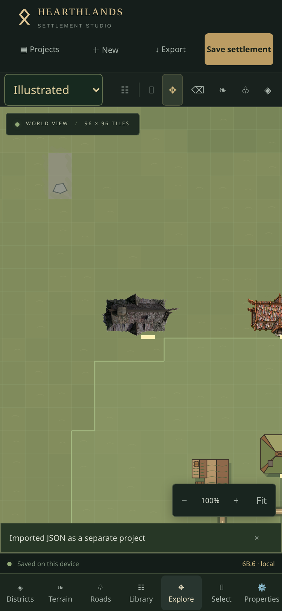
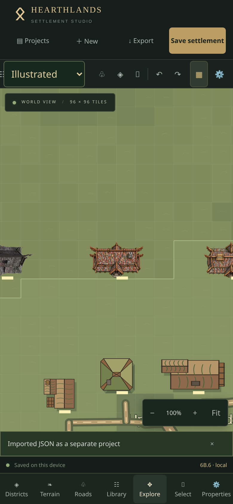
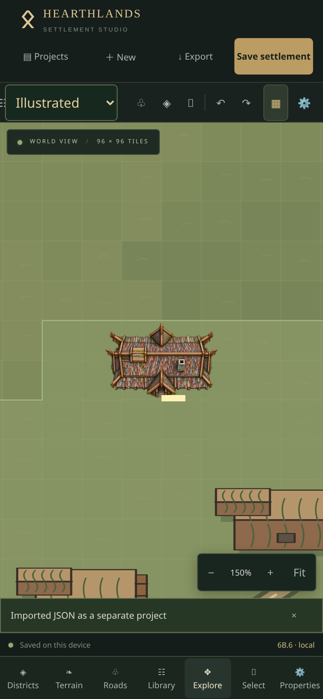
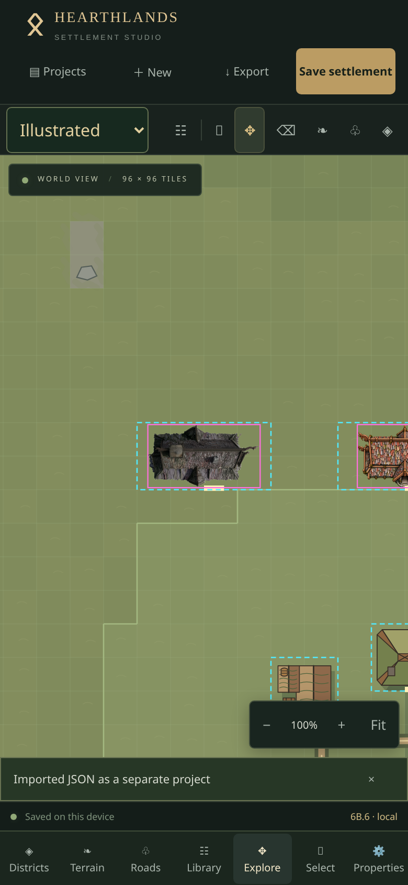
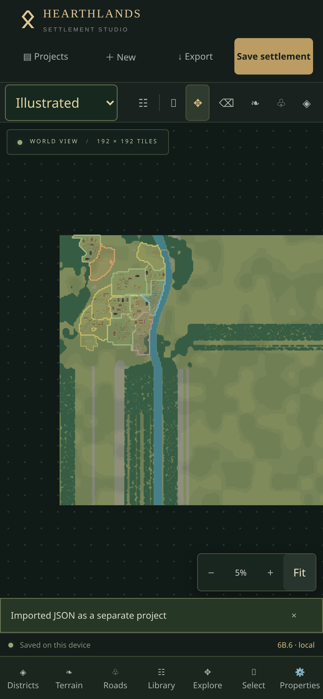

# Phase 6B.6 — Raster alignment and shadows

## Cause and correction

PNG artwork was being fitted as an entire padded canvas inside the fallback vector's coordinate box. The vector's independent X/Y scaling could distort a resized raster, and transparent padding left the visible roof smaller than intended. Illustrated rendering also drew a displaced, translucent shadow from the **fallback vector**, even when the visible building was a different PNG. This could produce unrelated rectangular dark patches.

Rasters now have **no separate renderer-generated shadow**, including during vector fallback after image failure. Vector Illustrated buildings keep their existing shadows; Planning is unchanged. No source PNG pixels or existing asset IDs changed.

An additive optional `artwork.visibleBounds` rectangle declares content in original PNG pixel coordinates. A build-time authoring audit measures every nonzero alpha pixel (alpha ≥ 1, including antialiased edges). The renderer crops only the transparent canvas border and uniformly contains the visible rectangle inside a 0.06-tile inset. One pixel-to-tile scale preserves native proportions at every footprint, zoom and rotation. The same `rasterGeometry` calculation feeds Konva, thumbnail SVG and full-map SVG/PNG. Reduced 256-pixel cached images use proportionally scaled source crops rather than new decodes.

| Custom PNG | Visible X/Y | Visible width × height | Original source |
| --- | --- | --- | --- |
| Ravenfjord Timber Longhouse 01 | 110 / 31 | 803 × 450 | 1024 × 512 RGBA |
| Ravenfjord Painted Timber Hall 02 | 158 / 22 | 707 × 468 | 1024 × 512 RGBA |
| Ravenfjord Mossy Timber Hall 03 | 160 / 22 | 704 × 468 | 1024 × 512 RGBA |

All three original SHA-256 checks continue passing. Both demo PNGs were audited too. Missing bounds remain compatible: the full source is contained proportionally. Invalid rectangles are rejected by registry validation. These are application asset definitions, **not settlement document fields**; no project migration or document rewrite is needed.

The bounds' aspect ratios differ from the functional 4×2 footprint. Some side space is intentional: filling both dimensions would require distorting or cutting visible roof artwork. Bounding-box centring preserves the complete architecture; it does not alter baked-in shading or perspective in the supplied PNGs.

## Interaction and data safety

The logical, rotation-aware footprint rectangle remains the only building hit region. Raster art and debug overlays are non-interactive. The hit rectangle's visible selection stroke no longer extends its clickable area beyond the logical footprint (`hitStrokeWidth=0`). Image crops stay inside that footprint; transparent original-canvas margins cannot intercept outside taps.

Positions, dimensions, collisions, entrances, roads, terrain, districts, generation, appearance IDs, locks and project JSON remain unchanged. Existing entrance/lock markers retain their previous logical placement. Selection outlines use the same footprint as before. Undo/redo and autosave continue storing document operations, never rendered pixels.

## Audit and optional debug tools

Run `python scripts/audit-building-alpha.py --check` to verify the committed bounds manifest, or `--write` after deliberately installing/replacing approved artwork and reviewing its bounds. The script prints dimensions, bounds and SHA-256; it never modifies PNGs. Python/Pillow is optional authoring tooling already available in the workspace, not a new npm/runtime/CI dependency. Future asset entries should reference their filename in `rasterBounds`.

For an optional development-only overlay, run the development server and reload with `?footprintDebug=1`. Cyan dashed rectangles show logical hit/collision footprints; magenta rectangles show rotated visible-image bounds. With the parameter absent, overlays are off. Production ignores the parameter. Nothing is saved in project data or included in PNG exports. This is a developer diagnostic, not a new user-facing editing tool.

## Verification

Production Chromium touch emulation at 390×844 compared all three custom PNGs at **Fit, 50%, 100% and 150%**, checked all four rotations and resizing, verified matching image/footprint bounds, zero raster shadow groups, outside-footprint touch rejection and unchanged documents after undo. Separate full-map PNG and building-free reference exports matched exactly at **60 sampled clear-margin pixels** around the three buildings. Actual browser-decoded alpha bounds matched every declared bound for all five installed PNGs. Forced decode failure retained visible vector fallback, exported successfully and added no raster shadow.

A DPR-3 100-building / 192×192 settlement containing 19 custom raster longhouses remained editable and unchanged while panning. Planning sampled approximately 16.7 ms median / 33.4 ms p95 / 50.1 ms worst frames; Illustrated approximately 16.7 / 33.4 / 50 ms. These workspace Chromium measurements do not establish physical iPhone performance. The existing bundle-size advisory remains; no dependencies were added.

## Exact physical iPhone checks

1. Reload the deployment without clearing Safari website data. Verify footer **6B.6** and the delivered commit. Duplicate Ravenfjord and open the duplicate.
2. Choose Illustrated, select a longhouse → Properties → Appearance → Traditional Viking. In turn apply **Ravenfjord Timber Longhouse**, **Ravenfjord Painted Timber Hall** and **Ravenfjord Mossy Timber Hall**. Confirm every original choice remains available.
3. For each, inspect at the displayed 50%, 100%, 150% zoom and Fit (pinch to adjust). Roof proportions and centring must remain stable; surrounding terrain should show through without an unrelated dark patch. Expect some side space where the native visible aspect differs from 4×2.
4. Tap within the logical rectangle to select it. Tap just outside it to clear selection. The selection outline should remain on the original logical footprint. Two-finger pan/pinch must not move the building.
5. Rotate through 0/90/180/270°. Resize via inspector, including a long narrow footprint; the artwork should contain proportionally rather than stretch. Undo these geometry changes. Test appearance Undo/Redo, Reset → Undo, locks and unlock.
6. Wait for Saved, close/reopen Safari and check the same appearance IDs and geometry. Export/import JSON as a separate project if desired; no debug or image-bound fields belong in settlement JSON.
7. Export complete Illustrated PNGs with each design at 2048 (1024 for lower memory; 4096 if available). In Files, inspect the roof, clean margins, rotation and full map. Grid, labels and districts should still work. No debug overlay or fallback-shaped raster shadow should appear.
8. Switch to Planning and verify clean symbols and editing remain familiar. Inspect a 75–100-building settlement, pan and pinch in both styles, and confirm normal responsiveness.

Physical iPhone Safari remains unverified; especially check native keyboard, downloads and memory on the device.

At 100% close zoom on the same 100-building map, median frame time remained 16.7 ms; the short pan sample showed intermittent slower frames (Planning p95 66.6 ms / worst 66.7 ms; Illustrated p95 83.4 ms / worst 100.1 ms). This is a limitation of the measured full-detail workspace run, not a physical-Safari performance guarantee. The existing Reduced visual-detail option remains available for slower devices. No terrain/performance redesign was introduced in this focused fix.

Final checks: **238 tests across 23 files passed**, production build passed, release verification passed, and the optional alpha audit `--check` passed. PNG source files, model/generator code and schema remain unchanged. [Complete exported map](screenshots/phase6b6/complete-map.png).
