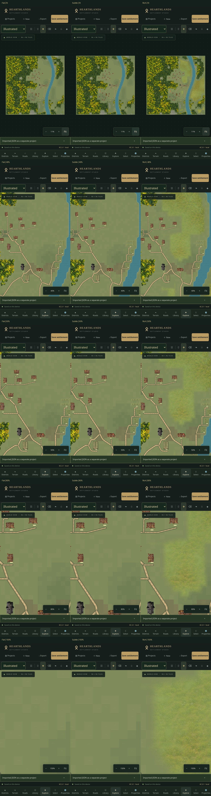

# Phase 6C.3.1 — Flat, Subtle and Rich ground

Properties → **Ground Detail** now offers:

* **Flat**: the original terrain, without meadow images or the continuous 6C.3 surface.
* **Subtle · recommended**: that same ground with sparse, small grass tufts, tiny flowers, shrubs and occasional rocky details. No photographic surface, large meadow stamps, broad brown/orange shading, image recolouring or new artwork is used.
* **Rich**: the existing 6C.3 continuous illustrated countryside, preserved for comparison.

These are browser visual preferences, independent of project documents and undo history. Planning mode ignores them. PNG export has its own **Ground Detail in PNG** selector, initially matching the editor preference. It uses output pixels per tile rather than camera zoom.

## Existing settings and data

There is no document migration. The optional `groundDetail` browser preference overrides older visual flags only after an explicit selection. Existing 6C.3 users remain in Rich; existing Flat users remain unchanged. An installation with the older meadow pilot enabled retains **Previous meadow pilot · preserved** until the user chooses a new mode. Its former setting stays available through **Restore previous meadow pilot**. Subtle is recommended in the menu, not silently enabled.

The six WebP assets, twenty approved tree canopies, custom building PNGs, source IDs and source files are unchanged. Forest placement/rendering, building presentation, water, roads, terrain data, project IDs, generators, snapshots, imports and history are not reworked.

## Subtle composition

`subtleGround.ts` creates small vector accents directly, rather than forcing detailed non-seamless WebPs into a different style. Uniform seeded world-space proposals are filtered by existing ground clearance queries, woodland proximity and distance from buildings. Positions are not tied to a placement grid. Neighbours are at least 2.4 tiles apart. Woodland fringes and uncultivated countryside receive most accents; all buildings have a five-tile quiet buffer, even when hidden or locked.

Only suitable open grass is eligible. Water, woodland interiors, cultivated ground, planned communal spaces, building entrances, roads, bridges and defenses remain protected. Each accent has a conservative clearance envelope. Gray-green rocks are more likely on elevated or rocky land. Muted green strokes and restrained pale-gold flowers leave the original sage-green ground dominant.

The seed-1847, 35-building Ravenfjord reference gets **30** accents across its entire 96×96 map, in three drawing batches. A village-centre close-up can deliberately look identical to Flat. Look near the outskirts for the difference; it is not a map-wide texture replacement.

Opacity increases smoothly from zero at 4 display pixels per tile to full at 12. At approximately 11% Fit the accents are absent; their positions and shape remain fixed as detail becomes legible. At 40–150% the same small shapes are used. Export uses identical paths and opacity decisions at the selected output density.

## Performance and implementation

Geometry is cached for four immutable world inputs and does not depend on the camera. At most four non-listening Konva shapes batch the accent types; internal 16-tile chunks allow native path culling. No image decodes, image surfaces, per-accent React nodes or texture memory are added for Subtle. Initial placement searches are bounded by map area. Camera movement reuses the existing geometry.

Production touch-pan timings (milliseconds; median / p95; Flat → Subtle):

| Map / buildings | Fit | 80% | Subtle accents |
| --- | --- | --- | --- |
| 96² / 35 | 16.7/16.8 → 16.7/16.7 | 16.7/50.0 → 16.7/50.1 | 30 |
| 128² / 75 | 16.7/16.8 → 16.7/16.7 | 16.7/33.4 → 16.7/33.4 | 111 |
| 192² / 100 | 16.7/16.8 → 16.7/16.8 | 16.7/50.0 → 16.7/50.0 | 376 |

These runs did not show a systematic p95 regression from Subtle. Close-view forest/building drawing still produced 33–50 ms p95 frames; the 100-building Subtle run had a 66.7 ms worst frame. This is not a claim of constant 60 fps or physical-device validation. Existing forest sprites, PNG image objects and Subtle path geometry were reused during pan.

The pure-function benchmark with 100 synthetic buildings, including fifty cache hits, measured 46.5 ms / 48.3 ms / 94.6 ms for 96² / 128² / 192² maps in this cloud environment. These are development measurements, not physical-iPhone guarantees. Synthetic open-land maps produced 104 / 271 / 722 accents respectively; actual village/forest scenes are more conservatively filtered.

See [verification data](screenshots/phase6c31/verification.json) for the separate production-build touch-pan measurements with 35, 75 and 100 buildings at DPR 3. The reference renderer's forest/building costs still apply; Rich retains its existing texture caches and resource limits.

## Comparisons and checks

Reference: Viking fishing village, river, contextual, seed 1847, 96×96, 35 buildings, with all twenty approved canopy assets enabled. The three columns below use identical camera positions. Rows are Fit, 40%, 50%, 80% and 150%.

Full-size examples: [Flat at Fit](screenshots/phase6c31/flat-fit.jpg), [Subtle at Fit](screenshots/phase6c31/subtle-fit.jpg), [Rich at Fit](screenshots/phase6c31/rich-fit.jpg), [Flat at 50%](screenshots/phase6c31/flat-50.jpg), [Subtle at 50%](screenshots/phase6c31/subtle-50.jpg), [Rich at 50%](screenshots/phase6c31/rich-50.jpg).

The village centre intentionally has almost no extra marks. [Subtle outskirts at 50%](screenshots/phase6c31/fringe/subtle-50.jpg) and [150%](screenshots/phase6c31/fringe/subtle-150.jpg) show the tiny accents near woodland. The reference focus is approximately tile (61.7, 88.1). Existing faint terrain marks are retained in every mode.

Validation completed:

* Complete automated suite: **370 tests across 33 files**; production build and release checks pass.
* Ten new tests cover legacy preferences, persistence without project writes, Flat/Rich preservation, Planning parity, deterministic geometry, clearance, sparse spacing, zoom presentation, shared SVG paths at 1024/2048/4096, and bounded large-map generation/cache reuse.
* Production Chromium touch emulation at 375×667, 390×844 and 844×390: panels scroll without horizontal overflow; building selection, rotation/undo and locking remain usable.
* Actual PNG downloads for Subtle at 1024/2048/4096, Flat at 1024 and Rich at 1024; JSON export/import, project isolation, IndexedDB preservation and real browser-profile close/reopen checked.
* Pixel comparison: Flat 1024 export is identical to the original clean-ground reference; Rich 1024 is identical to the previous 6C.3 export. All three styles retain the same 2,241 forest sprites and twenty canopy IDs in the reference views.
* No browser errors in those checks; selection/history operations leave the source document unchanged after undo. Ground preference changes never write to project documents.

## Physical iPhone acceptance

1. Reload the deployed app and check the footer says **6C.3.1** with the release commit. If an old tab persists, close it and reopen the site. Duplicate Ravenfjord and download a JSON backup first.
2. Choose **Illustrated** at the top. Open **Properties**, set **Forest artwork** to the approved twenty-canopy option if needed, and find **Ground Detail**. Before changing it, confirm that your previous Rich or meadow appearance was retained.
3. Choose **Flat**, return to **Explore**, tap **Fit** and compare the original green ground. Choose **Subtle** and repeat: Fit should still look predominantly clean green, without yellow/brown meadow blobs.
4. Pinch to about 40%, 50%, 80% and 150%. Pan toward woodland outskirts, including approximately (62, 88) on the reference map. Small tufts/flowers should appear gradually in fixed positions; the village centre, roads, fields and building surroundings should remain quiet. Use two fingers to pan/zoom while an editing tool is active.
5. Choose **Rich** and compare at the same locations: the previous continuous countryside should return. Select **Subtle** again. Forest crowns, building PNGs, entrances, roads and shoreline must retain their original arrangement and appearance.
6. Select a building, move or rotate it, undo and redo, then undo back to your starting state. Lock it and check that accidental movement is prevented. Exercise terrain, road and district tools normally; the accents must never intercept touch selection.
7. Close Safari, reopen the project and confirm Subtle remains selected. Check your settlements, restore points and manual building appearances remain intact. JSON import must create a separate project with the same geometry. Ground Detail is a browser preference, so it is intentionally not embedded in JSON.
8. Open **Export**, select **Illustrated** and **Ground Detail in PNG → Subtle**, then prepare/download 2048 pixels. Try 4096 if the phone has enough memory; use 1024/2048 on constrained devices. Save through Safari Downloads or Share → Save to Files. Repeat with Flat and Rich. Exports should cover the complete map and keep the approved forests/buildings unchanged.
9. Repeat pan/pinch with 75–100 buildings on a 192×192 map. Watch for input delays or Safari memory reloads and report the device/iOS version if encountered.

## Limits

Physical iPhone Safari testing is still required; Chromium touch emulation is not a substitute. Sparse accents intentionally disappear at Fit and can be absent from tightly packed settlements. Subtle does not remove the original terrain's cell-tone changes, elevation shading or pre-existing faint marks. No new texture artwork, forest system, water treatment or generation logic is introduced. Rich can still be busy and more expensive; it remains available rather than being visually changed by this release.
