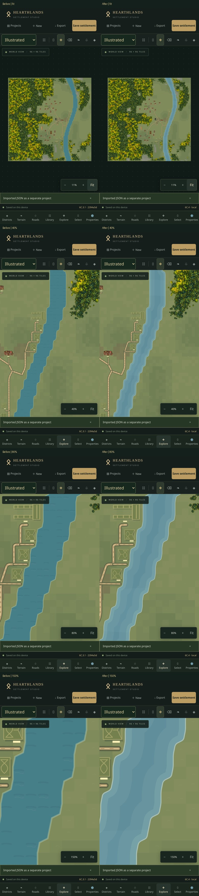

# Phase 6C.4 — Illustrated water, rivers and coastlines

Illustrated mode now uses a shared procedural water layer: a soft blue surface, broad quiet tonal washes, shallow bank bands, a narrow pale shoreline and sparse highlights. There are no new images, photographic textures, animated waves, new terrain types or document fields. Planning remains unchanged.

## Geometry and presentation

`waterGeometry.ts` reads the existing terrain query and the same centre/shared-corner coverage interpolation as the previous water renderer. Shared polygon edges cancel into oriented shoreline loops, including island holes. Corners receive short quadratic curves capped at **0.22 tiles**; long straight banks and map boundaries remain bounded. This is visual rounding only. Logical water cells, navigation, bridge validation, building footprints and terrain brushes are unchanged.

The mask supports rivers, isolated single-cell ponds, larger lakes, sea edges and fractional water coverage. Water beside marshy land uses the same clean water surface; adjacent land and the existing marsh artwork are not repainted. Shoreline shading is clipped inside the water mask, so no broad fuzzy halo spills onto fields, ground or forest art. Map edges do not get an artificial bank. In the defensive fallback for degenerate contour topology, original clipped faces remain drawable instead of losing water or throwing during rendering.

The blue palette and low-opacity broad washes are intentionally restrained. The bank bands imply shallow water rather than calculating physical depth. Small seeded highlights avoid banks, buildings and sampled infrastructure, including bridges. Water renders below roads, defenses, districts and buildings. The existing terrain relief layer remains intact.

The seed and world geometry determine every wash and highlight. No camera coordinates, frame times or rendering order enter placement. Water uses the same arrangement at Fit, 40%, 80% and 150%; automatic reduced-detail zoom does not swap or remove its artwork. The explicit Terrain detail setting can suppress fine highlights while retaining the water body and banks.

## Editor and exports

`WaterVisual.tsx` draws one non-listening native-path shape inside the existing terrain composition. It never intercepts touches or writes to the document. `waterSvg()` uses exactly the same mask, paint paths, colours and widths in complete-map SVG/PNG export, independently of the editor camera. Existing 1024/2048/4096 bounds and memory limits still apply.

Flat, Subtle and Rich ground modes, approved twenty-canopy forests, custom building PNGs, Planning mode, selection, movement, rotation, locks, roads, terrain editing, districts, generation, development, expansion, undo/history and persistence remain available.

## Comparisons

The reference is the existing 35-building seed-1847 Viking riverside map, with approved canopy artwork and Subtle ground. Before and after views use identical cameras, focused around tile (75, 46) at closer zooms. Full-size images include:

| Zoom | Previous water | Illustrated 6C.4 |
| --- | --- | --- |
| Fit | [Before](screenshots/phase6c4/before-fit.jpg) | [After](screenshots/phase6c4/after-fit.jpg) |
| 40% | [Before](screenshots/phase6c4/before-40.jpg) | [After](screenshots/phase6c4/after-40.jpg) |
| 80% | [Before](screenshots/phase6c4/before-80.jpg) | [After](screenshots/phase6c4/after-80.jpg) |
| 150% | [Before](screenshots/phase6c4/before-150.jpg) | [After](screenshots/phase6c4/after-150.jpg) |

The change favours clean contours and shallow edge bands over dense wave marks. It intentionally keeps some of the underlying terrain's shape rather than inventing new meanders or moving banks in project data.

Additional synthetic visual checks: [bridge at 80%](screenshots/phase6c4/bridge-80.jpg), [lake at 150%](screenshots/phase6c4/lake-150.jpg), [sea edge at 80%](screenshots/phase6c4/coast-80.jpg). The [water QA fixture](screenshots/phase6c4/water-reference.json) can be imported as a separate project; it contains a river, lake, small pond, damp bank, coast, approved building PNGs and a wooden bridge. It does not alter any real project or settlement generator.

## Validation and performance

* **381 tests / 34 files passed**, including eleven water tests. Production build and release verification pass.
* Coverage includes empty/fully wet maps, ponds, sinuous rivers, coasts, island holes, fractional coverage, checkerboards, narrow diagonal channels, twelve irregular masks, deterministic reload/duplication, immutable source documents, bridge/building highlight clearance, zoom-independent geometry, export parity and 96/128/150/192 map bounds.
* Planning output was compared directly with the committed 6C.3.1 renderer for all detail/reduced combinations; exact geometry fingerprints are retained as regression tests.
* Production Chromium touch emulation checks 375×667, 390×844 and 844×390 layouts, selection, rotation/undo, locks, legacy meadow/forest controls, JSON import/export, project isolation and a real persistent browser-profile close/reopen.
* Actual Illustrated PNG downloads were checked at 1024, 2048 and 4096 pixels. At 1024, pixels outside a conservative 1.5-tile water/bank buffer match the previous Flat export exactly. The approved twenty forest IDs and 2,241 sprite placements remain unchanged in the reference views.

The isolated pure-geometry run measured **26.5 / 36.0 / 37.4 / 76.4 ms** cold for 96² / 128² / 150² / 192² river-and-coast fixtures. Results include 39 / 70 / 89 / 176 highlights respectively. Camera movement reuses the same bounded four-entry scene cache and native paths. There is no bitmap allocation or Konva node per water cell, no per-frame random generation and no new asset download. Existing bounded terrain overview caches continue to apply.

Production touch-pan measurements for 35 buildings on 96² and 100 buildings on 150²/192² are recorded in [verification data](screenshots/phase6c4/verification.json). They are cloud Chromium measurements at DPR 3, not physical iPhone or constant-frame-rate guarantees.

Production Illustrated/Subtle timing observations (milliseconds):

| Map / buildings | Fit median / p95 | 80% median / p95 |
| --- | --- | --- |
| 96² / 35 | 16.7 / 16.7 | 16.7 / 50.0 |
| 150² / 100 | 16.7 / 33.3 | 16.7 / 33.4 |
| 192² / 100 | 16.7 / 16.8 | 16.7 / 50.1 |

The 192² close-view run had a 66.7 ms worst frame. These timings include all existing forests and buildings, not just water. They do not establish physical-iPhone frame rates.

## Physical iPhone checks

1. Reload the deployed app and verify **6C.4 · commit** in the footer. Close an old Safari tab and reopen if the previous release persists. Duplicate Ravenfjord and keep a JSON backup.
2. Choose **Illustrated** and your existing Ground Detail mode. Leave the approved twenty-canopy forest setting unchanged. At **Fit**, rivers and coastlines should remain clearly blue and readable; buildings, districts and forests should keep their usual appearance.
3. Explore a river at approximately **40%, 80% and 150%**. Inspect the narrow bank outline, shallow inner bands and sparse highlights. Pinch continuously between these scales: water should retain its shape, with no generic replacement, flicker or moving texture.
4. Inspect an existing bridge. Its deck and rails must remain clear above water, with both banks unchanged. Select the bridge or a nearby building and test ordinary editing, rotation/undo and locking. Use explicit Pan or two fingers while an editing tool is active.
5. Inspect a small pond, a lake, a sea edge and water adjoining damp ground. If drawing a temporary pond, do it in the duplicate, confirm terrain protection warnings as appropriate, then undo/redo the stroke. No neighbouring structures should be removed or moved.
6. Switch to **Planning** and confirm the original technical water view. Switch back to Illustrated, cycle **Flat / Subtle / Rich**, and verify the same water composition remains. Close/reopen Safari and check the saved project and visual settings.
7. Export **Illustrated** at 2048 pixels with your chosen ground/district/grid options; download through Safari or Share → Save to Files. Try 1024 on constrained devices and 4096 only if memory allows. Inspect the complete river, ponds, coast and bridges. Export Planning separately to confirm it retains its original appearance. JSON export/import must preserve the settlement independently of visual mode.
8. Pan and pinch a 150×150 map with 75–100 buildings and forests. Report device/iOS version and any noticeable input delay or Safari reloads.

## Limits

Physical Safari hardware is not available in this environment; it still needs the checks above. Shoreline rounding is restrained and visual, so coarse hand-painted terrain remains recognisable rather than becoming a new geographic layout. Bank shading is stylised, not a hydrology/elevation simulation. There are no animations, river-flow arrows, new marsh assets or water-specific gameplay changes. Existing main-bundle size warnings and the resource costs of forests, buildings, Rich ground and high-resolution exports remain.
