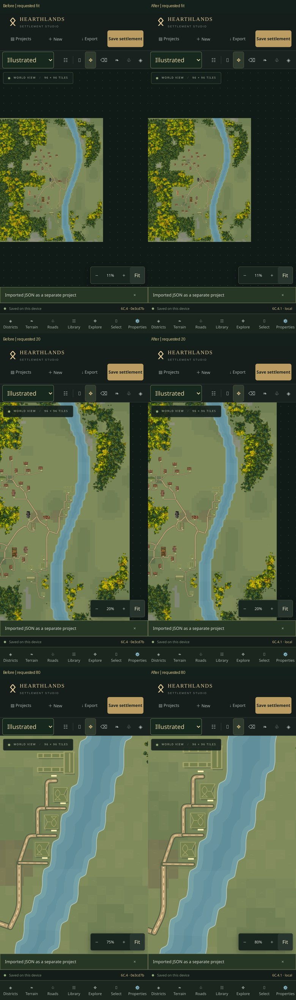

# Phase 6C.4.1 — Continuous water zoom stability

This release changes camera handling and terrain-cache composition, not the approved water artwork, terrain, generation or project schema. The physical-iPhone report did not identify the exact symptom. Two risks were investigated; only the camera jump was reproduced conclusively in Chromium. Physical Safari revalidation remains necessary.

## Findings

1. **Confirmed camera jump:** Fit can be below the old 12% pinch minimum (about 10.6% for the portrait 96² reference and 5.3% for 192²). A small outward pinch was immediately clamped upward. Subsequent distance ratios amplified the unwanted zoom, even though the world anchor and water geometry stayed fixed. Touch-driven baseline runs reproduced this on both maps.
2. **Confirmed cache churn, uncertain Safari symptom:** water was inside a cached terrain ancestor. Crossing 3, 6 and 10 display pixels per tile changed bitmap resolutions (4, 8, 12 pixels per tile, bounded to 2048 pixels per edge), then switched to native vectors. Auto detail also changes terrain paths at 7 pixels per tile. Baseline runs rebuilt water-containing caches 7/8 times; a 192² rebuild took about 207 ms in one run. Resampling and large canvas replacement were potential contributors to Safari instability, but Chromium did **not** reproduce disappearing water or seeded-highlight movement.

The existing `waterGeometry.ts`, `WaterVisual.tsx`, colours, shorelines, masks, paints and SVG/PNG exporter remain unchanged. Tests found stable water geometry even before this fix; there was no evidence of a random reseeding bug.

## Fix

* The existing water node now renders natively **outside** terrain overview caches, between the original nature and relief layers. It never changes between a water bitmap and native vectors during a pinch. Forest and ground artwork retain their existing caching and detail logic. No second water renderer, bitmap system, image asset or dependency was added.
* Terrain cache replacement uses Konva's synchronous offscreen build/publication, without an extra clear-before-build and per-change cleanup. Effective capped ratios are dependencies, avoiding work when the requested resolution changes but the effective ratio does not. Failed builds retain native drawing as the fallback and request a redraw. Unmount still releases the cache.
* Fit, wheel/button zoom and pinch share bounded camera maths. Mobile can zoom to half Fit rather than jumping to 12%; the existing desktop lower bound and 300% maximum remain. Pinch starts from the actual two-finger distance/centre instead of dropping the first move. Degenerate distances and touch cancellation reset safely. Viewport/browser-toolbar resizing cannot force a current camera abruptly to a newly calculated bound.
* Two-finger start still cancels uncommitted terrain/district/building/infrastructure gestures. A remaining finger cannot paint or move a building accidentally; a fresh primary gesture is required.

Planning retains its original combined terrain surface and artwork. Water's draw order, world coordinates, cached native paths and document data are unchanged. The native editor no longer resamples an overview water bitmap, so subpixel antialiasing can differ at small zooms; the approved shapes/paints are identical. At close zoom both old and new renderers use the same native artwork. Full-map SVG/PNG output is unchanged.

## Cache, memory and performance

Water uses its existing single non-listening draw node and decoded native paths. No additional full-map water canvas, image pyramid or double buffer is allocated. Existing forest/ground bitmap bounds remain 2048 pixels per edge. Relief stays above water as native paths, avoiding an extra full-map relief bitmap. The bounded geometry cache is unchanged and camera movement never regenerates water, highlights or seeded placement.

Native water is drawn on each world-layer frame; it no longer incurs water-containing raster rebuilds. Forest/ground cache rebuilds and Rich ground's existing asynchronous surface work can still consume time. This release does not claim to eliminate every whole-map frame hitch or Safari GPU limitation.

## Regression evidence

* **388 tests / 35 files pass.** Seven new cases cover mobile Fit limits, continuous forward/reverse zoom and threshold oscillation, moving pinch centres, invalid/cancelled touch samples, immutable water geometry/highlights/exports, Planning composition and bitmap bounds.
* Production touch-driven runs use the seed-1847 35-building riverside reference and a 100-building 192² forest-heavy settlement. Each traverses Fit, 20%, 40%, 80%, 100% and 150% in both directions, with repeated slow crossings of cache/detail thresholds.
* Flat/Subtle/Rich × Auto/Reduced are checked on both maps. Water node/draw-function identity, parent cache state, scale/anchor errors and rendered water pixels are recorded, including frames while fingers are down. Additional cases exercise a small pond, lake, coast and bridge. A pinch with an active Raise terrain brush is checked against the saved document.
* Before runs show scale errors from the hard minimum and water-containing cache builds. After runs have zero water-containing cache builds, no water-node/draw-function replacements and no missing-water samples. Small numeric scale/anchor errors are limited to browser touch-coordinate precision.
* Actual downloads of Flat 1024, Subtle 1024/2048/4096 and Rich 1024 PNGs are **pixel-identical to 6C.4**. Building selection/rotation/undo/locks, three mobile viewport layouts, legacy meadow/forest options, JSON isolation and real browser-profile close/reopen also pass.

All 16 touch scenarios passed: **2,356 sampled movements**, zero missing-water samples, zero water-containing cache builds and zero water node/draw-function changes. A fresh one-finger Raise stroke after brush/pinch cancellation also saved successfully and was undone back to the exact source document.

Paired 100-building 192² production measurements (cloud Chromium, median / p95 milliseconds):

| Mode / zoom | 6C.4 | 6C.4.1 |
| --- | --- | --- |
| Subtle / Fit | 16.7 / 49.9 | 16.7 / 33.4 |
| Subtle / 80% | 16.7 / 66.7 | 16.7 / 66.7 |
| Flat / 80% | 16.7 / 83.3 | 16.7 / 50.1 |
| Planning / 80% | 16.7 / 66.7 | 16.7 / 66.7 |

These sequential, isolated runs show no sustained regression, not proof of a specific speedup or iPhone frame rate. Frame-time noise and occasional hitches remain.

See [machine-readable evidence](screenshots/phase6c41/verification.json). [Before Fit](screenshots/phase6c41/before-35-subtle-auto-fit.jpg), [before requested 20%](screenshots/phase6c41/before-35-subtle-auto-20.jpg), [after Fit](screenshots/phase6c41/after-35-subtle-auto-fit.jpg), [after 20%](screenshots/phase6c41/after-35-subtle-auto-20.jpg), [40%](screenshots/phase6c41/after-35-subtle-auto-40.jpg), [80%](screenshots/phase6c41/after-35-subtle-auto-80.jpg), [150%](screenshots/phase6c41/after-35-subtle-auto-150.jpg). 

The before screenshot's actual zoom can exceed its requested target because that is the reproduced failure.

Bridge frames captured **during** a continuous gesture: [just above 10 px/tile](screenshots/phase6c41/after-35-subtle-auto-bridge-during-0.315.jpg), [just below](screenshots/phase6c41/after-35-subtle-auto-bridge-during-0.31.jpg), [above 6 px/tile](screenshots/phase6c41/after-35-subtle-auto-bridge-during-0.19.jpg), [below](screenshots/phase6c41/after-35-subtle-auto-bridge-during-0.185.jpg), [above 3 px/tile](screenshots/phase6c41/after-35-subtle-auto-bridge-during-0.095.jpg), [below](screenshots/phase6c41/after-35-subtle-auto-bridge-during-0.09.jpg).

The optional reproducible browser harness is `scripts/check-water-zoom.cjs`. It requires a separately available Playwright runtime; it is not added to app dependencies. Start the production preview on port 4220, then run:

```sh
PLAYWRIGHT_MODULE=/path/to/playwright node scripts/check-water-zoom.cjs after 35 subtle auto
PLAYWRIGHT_MODULE=/path/to/playwright node scripts/check-water-zoom.cjs after 100 rich reduced
```

`WATER_URL` selects a different production preview; `WATER_FIXTURE`, `WATER_FOCUS` (JSON), `WATER_CASE`, `CHECK_BRUSH=1` and `CAPTURE_TRANSITIONS=1` support body-specific checks. Fixture imports happen in isolated temporary browser profiles. The supplied [expanded reference](screenshots/phase6c41/expanded-reference.json) is test data, not a migration of any user project.

## Exact physical-iPhone acceptance

1. Keep the current Safari installation and project data. Duplicate Ravenfjord and keep a JSON backup. Reload the app and confirm footer **6C.4.1 · commit**. Close an old tab and reopen if needed; **do not clear site data**.
2. Choose Illustrated, approved twenty-canopy forests and Subtle ground. Tap Fit. Put two fingers on a river and make a very small outward pinch. The 96² and 192² maps must grow gradually from Fit, without jumping to 12% or a much larger view.
3. Keep both fingers down and zoom slowly through **Fit → 20 → 40 → 80 → 100 → 150%**, then back. Pause and reverse repeatedly around **9.4%, 18.75%, 21.9% and 31.25%** (3/6/7/10 display pixels per 32-pixel tile). Start another gesture if finger travel is exhausted. Banks, shading and highlights must stay attached to the same world locations, with no blank frames or sudden water-style changes.
4. Repeat over a small pond, lake, coast and bridge. The bridge deck, rails, nearby buildings, forest edges and water must stay aligned. Try Flat/Subtle/Rich and Auto/Reduced visual detail; the water arrangement must be identical.
5. Open Terrain and activate Raise terrain. Put down one finger, then add the second before releasing. Pinch/pan, lift one finger and move the remaining finger. No brush stroke may be committed. Start a fresh one-finger stroke on safe land to confirm painting still works, then undo it. Test the explicit Pan tool and ordinary one-finger pan separately.
6. Select a building, move/rotate it, undo/redo, lock/unlock and verify original hit regions. Check a road and bridge. Switch to Planning and back; the original Planning appearance must remain.
7. Repeat the slow reversals on the 100-building 192² forest-heavy map. Note any pauses separately from flicker/disappearance/shape changes. Test portrait and landscape, and Safari's expanded/collapsed browser bars.
8. Close/reopen Safari, confirm saved edits and appearance choices, export/import JSON as a new project, then export Illustrated PNG at 2048 pixels (1024 on constrained phones; 4096 if memory permits). Water artwork must match 6C.4.

If the failure remains, record the iPhone model/iOS version, ground/detail mode, starting zoom, direction, exact visible symptom and whether the entire map or water alone moved. A short screen recording is the most useful next evidence. Chromium emulation, readback samples and screenshots cannot guarantee physical Safari compositor behaviour.
