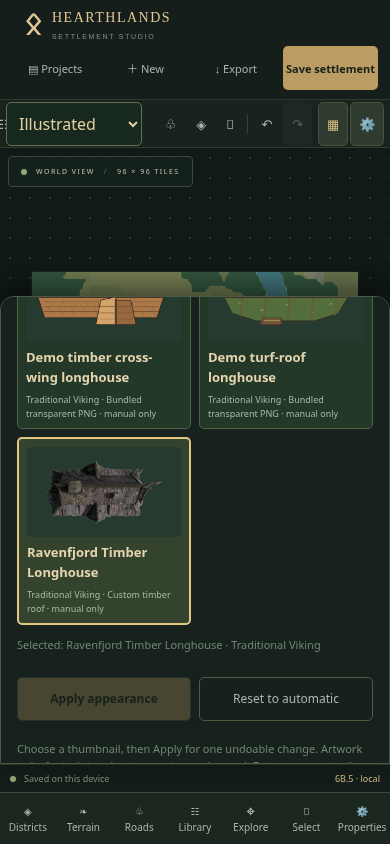
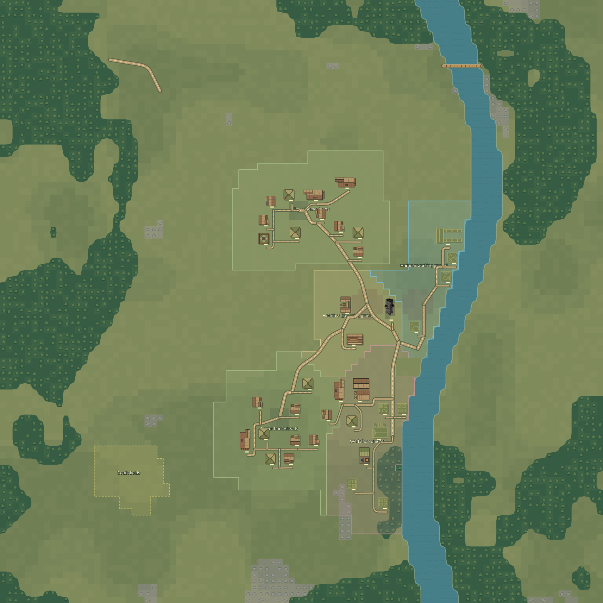

# Ravenfjord Timber Longhouse — first custom appearance

Installed the supplied `hearthlands-viking-longhouse-01.png` unchanged at `src/assets/buildings/png/hearthlands-viking-longhouse-01.png`. The file is a 1024×512, 8-bit RGBA PNG with transparent pixels, 535,797 bytes. SHA-256:

`f54d972d5ce2755fdfd853c2d9d6bf8f5c56b12df4a6e9b8c28ec67e7b9a6e38`

- ID: `hearthlands.viking.longhouse.01`
- Name: **Ravenfjord Timber Longhouse**
- Kind/theme: longhouse / Traditional Viking
- Nominal footprint: 4×2 tiles; canonical orientation 0°
- Manual selection only (`automatic: false`)
- Fallback: existing `starter.viking.longhouse.2` vector artwork

The existing Phase 6B.5 PNG pipeline supplies thumbnails, Illustrated map rendering and self-contained full-map PNG/SVG output. No renderer, interface, settlement generator, document schema or persistence changes were needed. Existing asset IDs and the automatic eligible pool remain unchanged. No other custom designs were installed. Project JSON continues to store just the selected asset ID.

## Physical iPhone verification

1. Reload the deployed application without clearing Safari website data. Verify the footer's **6B.5** commit matches this installation's delivered commit. Duplicate Ravenfjord before testing.
2. Choose **Illustrated**, select a longhouse, open **Properties → Appearance** and filter **Traditional Viking**.
3. Scroll to **Ravenfjord Timber Longhouse**. Verify the thumbnail is the supplied artwork; choose it and tap **Apply appearance**. Return to the map and zoom in. Terrain should show through its transparent margins.
4. Move the building, rotate 90° and edit its width/height. The artwork should follow without changing the logical entrance, selection region or collision rules. Undo geometry edits, then test appearance Undo/Redo and Reset to automatic → Undo.
5. Lock it and verify appearance changes are disabled. Unlock, wait for Saved, close/reopen Safari and confirm the artwork remains. Duplicate the project or restore a named snapshot and confirm the selected asset is retained.
6. Download JSON and import it as a separate project. Confirm `hearthlands.viking.longhouse.01` and the same artwork remain. The image itself is bundled in the application, not the JSON.
7. Export complete **Illustrated** PNGs at 1024/2048 (4096 if memory permits), open them in Files and inspect the roof, rotation, transparent edges and full map bounds. Test grid/labels/district options normally.
8. Switch to **Planning**. Existing clean symbols and editing should remain unchanged. Switch back to Illustrated and confirm the custom choice remains.

Physical iPhone Safari requires hands-on verification; browser touch emulation cannot establish device-specific memory or download behaviour.

## Production-browser evidence

Touch emulation at 390×844, 375×667 and 844×390 verified the actual custom thumbnail and raster map node, move/rotate/resize, locks, Reset and Undo/Redo, theme changes, autosave, browser restart, separate JSON import, district development, complete PNG downloads at 1024/2048/4096 and unchanged Planning. No page errors or horizontal overflow were observed. The supplied artwork was also visually inspected in the complete exported map.

Automated checks: **220 tests across 22 files passed**, production build passed and release verification confirmed the custom asset ID/name in the compiled bundle. Vite retains its large-chunk advisory; bundling this supplied PNG adds approximately 535 kB to the compressed initial JavaScript download. No dependencies were added.
