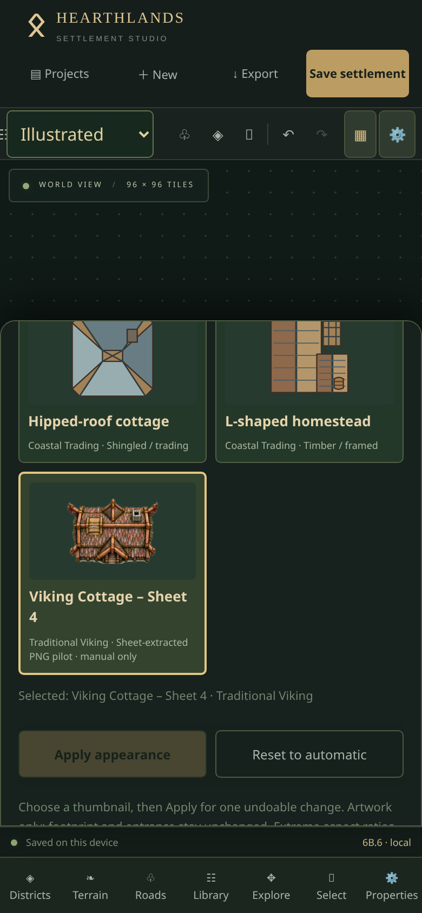
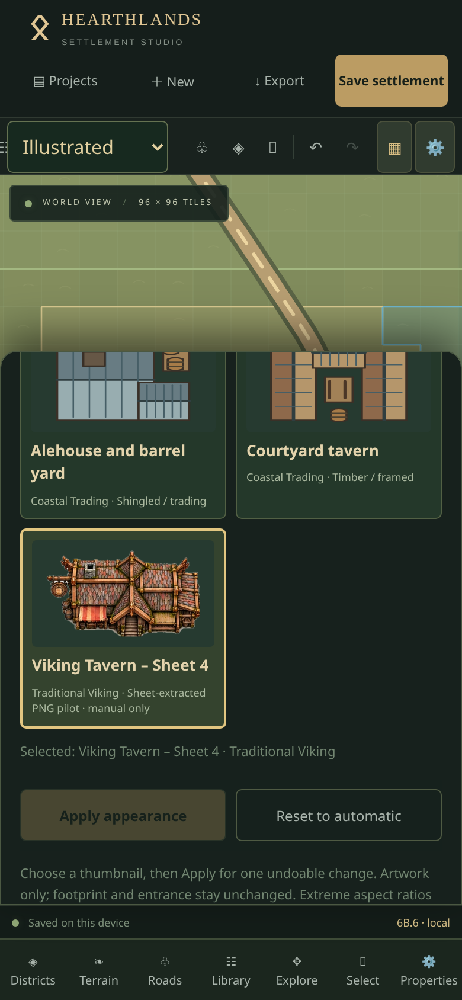
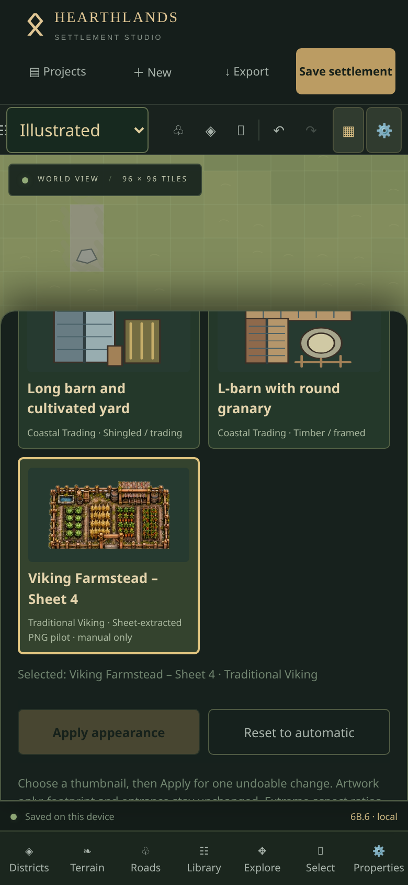

# Sheet 4 manual-only asset pilot

Installed exactly the Cottage, Tavern and Farmstead from the supplied `Hearthlands_Sheet_4_Pilot.zip`, following its `CODEX-INSTALL-PILOT.txt`. Market, Town Hall and Warehouse extracts are not installed. The three PNG files are unchanged archive bytes; no replacement artwork, cleanup, cropping or resampling was applied to the files.

| Appearance / stable ID | Functional kind | Nominal footprint | Actual RGBA canvas | Nonzero-alpha bounds (x, y, width, height) |
| --- | --- | --- | --- | --- |
| Viking Cottage – Sheet 4 / `hearthlands.sheet4.cottage.01` | cottage | 2×2 | 768×768 | 34, 133, 699, 502 |
| Viking Tavern – Sheet 4 / `hearthlands.sheet4.tavern.01` | tavern | 3×2 | 1024×768 | 46, 121, 932, 526 |
| Viking Farmstead – Sheet 4 / `hearthlands.sheet4.farm.01` | farm | 4×3 | 1024×768 | 46, 123, 932, 522 |

All use Traditional Viking architecture, canonical orientation 0°, the matching existing vector fallback, and `automatic:false`. There are now 89 catalogue entries; the original 81 automatic entries and every previous asset ID remain intact. Existing projects retain their appearance choices and geometry. No document migration, generator, renderer, UI or persistence redesign is involved.

The existing static image allowlist embeds approved local PNGs in the production bundle. Shared alpha-bound fitting contains each original aspect ratio inside its functional footprint; it does not stretch the square Cottage canvas or invent detail. Thumbnails, Illustrated canvas and complete-map SVG/PNG exports use the same source and fitting. Planning mode retains its vector symbols. No separate fallback-shaped shadow is added for raster assets. Only stable appearance IDs enter saved documents.

## Source quality and limitations

The archive README describes these as extracted visual pilots, not production-approved artwork. Original effective detail is approximately **234×168** (Cottage), **312×176** (Tavern), and **298×167** (Farmstead), upscaled into the larger supplied canvases. Large exports cannot recover missing detail. Pale paper/edge remnants and shadows already embedded in the art remain visible, especially against grass. The Farmstead crop ends along its lower fence and side details; application fitting preserves all supplied nonzero-alpha pixels but cannot restore anything missing in the original sheet extraction. No alpha reaches the outer PNG canvas edges. Source licensing/attribution must be confirmed by the artwork owner before treating these pilots as final production artwork.

The production entry bundle is approximately **6.12 MB uncompressed / 4.20 MB gzip** after installing these three PNGs. Existing inline-image packaging increases the initial download size; no remote assets or runtime uploader are introduced. Do not make these entries automatic without explicit approval. See [bundled-image authoring](phase6b5-image-assets.md) and [alpha fitting](phase6b6-raster-alignment.md) for the existing architecture.

## Physical iPhone verification

1. Reload the deployed app without clearing Safari website data. Check the footer commit against the installation commit. The phase marker remains **6B.6**; its commit distinguishes this pilot installation.
2. Open Projects, duplicate Ravenfjord and open the duplicate. Select **Illustrated**. Existing longhouse appearances must remain available and unchanged.
3. Select a cottage → Properties → Appearance. With All architecture themes or Traditional Viking selected, tap **Viking Cottage – Sheet 4**, then **Apply appearance**. Repeat for a tavern using **Viking Tavern – Sheet 4**, and a farm/barn using **Viking Farmstead – Sheet 4**. If Ravenfjord has no farm, manually place a Farm / barn on the duplicate first.
4. Inspect each at Fit, 50% and 100% using pinch zoom. Roof/fence proportions should remain stable. Check pale source edges against grass; no additional dark rectangle should appear. Pan with Explore; return with Select. Tap the logical footprint, then just outside it, to check selection.
5. Rotate each through 0/90/180/270°, resize via Properties, and move it. Appearance should remain centred and proportional. Undo temporary geometry edits. Test appearance Undo/Redo, Reset to automatic → Undo, and Lock (appearance controls disabled) → Unlock.
6. Scroll the appearance panel in portrait and landscape. Cards and Apply/Reset must remain tappable without horizontal overflow or floating-toolbar overlap.
7. Wait for Saved on this device, close/reopen Safari, and confirm all three manual choices persist. Export JSON and import it as a separate project; appearances must retain their IDs and original projects must remain intact.
8. Export a complete Illustrated PNG at 1024 and 2048 px (4096 if device memory permits). Save to Files and inspect all three appearances, transparency, rotation and complete map bounds. Switch to Planning: clean symbols and normal selection/editing must remain unchanged.

Browser emulation cannot replace physical Safari verification of touch, native downloads, keyboard and memory limits.

## Verification evidence

Automated checks: **250 tests across 24 files passed**; `npm run build`, `npm run verify:release` and `python scripts/audit-building-alpha.py --check` passed. The nine new pilot checks cover exact source hashes/header dimensions, the three-entry scope, manual-only eligibility, stable automatic choices, matching fallbacks, lock/history/reset/JSON behavior, native aspect fitting, rotations and embedded export pixels at 1024/2048/4096. IndexedDB recovery coverage now includes each pilot through autosave, project duplication/isolation, reopening and named snapshot restoration. Existing generator, district development, expansion, terrain and infrastructure regressions pass.

Source SHA-256:

- Cottage: `3f7a751f3f685e5de79bbd998ee54d2500986c44fdc03a02c3c697363c9b7cfd`
- Tavern: `7eb76ae1773e74b20ad0a6fcc51b85868f190f23e9ede2878df33ca7a16c348c`
- Farmstead: `93a6d47899f04458237247b5f0a60926aeb3b52d87211374c30e032d6d2b8003`

Production-build Chromium touch checks passed at **390×844**, **375×667** and **844×390**. In an isolated browser profile, imported a 35-building Ravenfjord, duplicated it with Projects and manually placed a farm (the reference village had none). Applied all three appearances through actual touch UI; tested thumbnail/image decode, camera isolation, Fit/50%/100%, pan/pinch, 0/90/180/270° rotation, move/resize with Undo, appearance Undo/Redo/Reset, and locks. After undoing temporary geometry edits, compared the saved document: only the three chosen appearance fields differed; every pre-existing building, road, terrain cell, landscape, district and planning field remained unchanged. The panel had no horizontal overflow in all three sizes.

Downloaded complete Illustrated PNGs at **1024, 2048 and 4096 px**, checked PNG dimensions, and inspected the complete 2048 map. JSON download/import created a separate project with the same appearance IDs. Closed/reopened the browser using the same temporary profile and verified persisted documents; switched to Planning and confirmed raster art was absent without document changes. No page errors occurred. These are Chromium emulation results, not a claim of physical-iPhone Safari testing.

[Complete 2048-pixel Illustrated export](screenshots/sheet4-pilot/complete-map.png). Map closeups: [Cottage](screenshots/sheet4-pilot/cottage-map-100.png), [Tavern](screenshots/sheet4-pilot/tavern-map-100.png), [Farmstead](screenshots/sheet4-pilot/farm-map-100.png).

A short production touch-pan sample on a **192×192 map with 100 buildings (41 pilot images), 390×844 at DPR 3**, measured median frame intervals of **16.7 ms**, p95 **33.4 ms** in both styles; worst **50.0 ms Planning / 33.4 ms Illustrated**. The saved source document was unchanged. This desktop Chromium emulation sample does not predict performance on every iPhone. [Illustrated overview](screenshots/sheet4-pilot/performance-illustrated.png).
